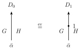

This repository standardizes and formalizes the conjugated string-diagram language of [*Bimodule String Diagrams and the Generalized Mackey Decomposition*](https://getcurious.cc/downloads/mackey-bimodules.pdf) in Lean. It gives diagrams an explicit syntax and geometry, then proves how they evaluate to bimodule maps. This makes diagrammatic identities precise while preserving the distinction between a drawing, its shape, and the map it represents.

Regions are labelled by subgroups of an ambient group. Ordered strings carry induction or restriction orientations and conjugation embeddings, with conjugator labels identified by the appropriate centralizer cosets. Dots are finite **ℂ-linear combinations of eligible group elements**, with eligibility checked for every supported term. Cups, caps, trivalent merges and splits, and mixed and parallel crossings have concrete constructors with specified source and target boundaries and the required compatibility and finiteness data. Horizontal tensoring, vertical stacking, and indexed sums retain their scopes. Planar shapes preserve orientations, marked vertices and positioned wiring, with disjoint operations allowed to interchange.

For fixed boundary objects $X,Y$, let $V(X,Y)$ be the space of finite formal complex linear combinations of admissible diagrams. Evaluation is a linear map to bimodule homomorphisms. The diagrammatic hom-space is its kernel quotient:

$$
\mathrm{Hom}_{\mathrm{diag}}(X,Y)
= V(X,Y)/\ker(\mathrm{ev}_{X,Y})
\cong \mathrm{im}(\mathrm{ev}_{X,Y}).
$$

Thus two combinations represent the same quotient class exactly when their evaluated bimodule maps agree; their underlying drawings and shapes remain distinct data. Stacking descends to bilinear, associative composition with identity diagrams. For $X=Y$, it gives an **associative unital ℂ-algebra** of diagram-presented endomorphisms. For a finite family of boundary objects with fixed outer groups, the block-algebra construction also includes diagrams with different bottom and top objects: compatible blocks multiply by stacking, incompatible blocks multiply to zero, and the unit is the sum of the identity blocks. Diagrammatic equations are interpreted as equalities of evaluated maps; finite formal expressions can equivalently be compared by their quotient classes.

Exact statements, source locations, and proof status are recorded in [PROJECT.md](PROJECT.md). The [35 categorical prerequisites](prerequisites/README.md) are included in this repository. The formalization works over a commutative coefficient ring, with the paper's language obtained by specializing to ℂ; [DIAGRAMS.md](DIAGRAMS.md) describes the precise Lean representations and conventions.

### A simple TikZ example

Both strings carry the same conjugation label. The dot is the coefficient-one identity label: inserting it leaves the evaluated bimodule map unchanged, while retaining the visible mark in the drawing. Lean proves this in [`DotLabel.upDrawing_identity`](MackeyDiagrams/DotLabels.lean).

[TikZ source](docs/identity-dot.tex) · [Rendering commands](docs/README.md).
