# Bimodule String Diagrams and the Generalized Mackey Decomposition

This repository standardizes and formalizes the conjugated string-diagram language of [*Bimodule String Diagrams and the Generalized Mackey Decomposition*](https://getcurious.cc/downloads/mackey-bimodules.pdf) in Lean. It gives diagrams an explicit syntax and geometry, then proves how they evaluate to bimodule maps. This makes diagrammatic identities precise while preserving the distinction between a drawing, its shape, and the map it represents.

Regions are labelled by subgroups of an ambient group. Ordered strings carry induction or restriction orientations and conjugation embeddings, with conjugator labels identified by the appropriate centralizer cosets. Dots are finite **ℂ-linear combinations of eligible group elements**, with eligibility checked for every supported term. Cups, caps, trivalent merges and splits, and mixed and parallel crossings have concrete constructors with specified source and target boundaries and the required compatibility and finiteness data. Horizontal tensoring, vertical stacking, and indexed sums retain their scopes. Planar shapes preserve orientations, marked vertices and positioned wiring, with disjoint operations allowed to interchange.

For fixed boundary objects $X,Y$, let $V(X,Y)$ be the space of finite formal complex linear combinations of admissible diagrams. Evaluation is a linear map to bimodule homomorphisms. The diagrammatic hom-space is its kernel quotient:

$$
\operatorname{Hom}_{\mathrm{diag}}(X,Y)
= V(X,Y)/\ker(\operatorname{ev}_{X,Y})
\cong \operatorname{im}(\operatorname{ev}_{X,Y}).
$$

Thus two combinations represent the same quotient class exactly when their evaluated bimodule maps agree; their underlying drawings and shapes remain distinct data. Stacking descends to bilinear, associative composition with identity diagrams. For $X=Y$, it gives an **associative unital ℂ-algebra** of diagram-presented endomorphisms. For a finite family of boundary objects, the block-algebra construction also includes diagrams with different bottom and top objects: compatible blocks multiply by stacking, incompatible blocks multiply to zero, and the unit is the sum of the identity blocks. Diagrammatic equations are interpreted as equalities of evaluated maps; finite formal expressions can equivalently be compared by their quotient classes.

All 143 inventoried article results and their supporting active endpoints have passed Lean compilation, axiom audits, dependency review, and the complete-library build. The [35 categorical prerequisites](prerequisites/README.md) are included in this repository. The formalization works over a commutative coefficient ring, with the paper's language obtained by specializing to ℂ; [DIAGRAMS.md](DIAGRAMS.md) describes the precise Lean representations and conventions.

All listed results compiled and passed the axiom audit.

[Article](https://getcurious.cc/downloads/mackey-bimodules.pdf) · [Alphabeta Math](https://getcurious.cc/articles/math-bimodule-string-diagrams)

## Dependency overview

20 landmark definitions and results. Arrows follow dependency paths, with intermediate items omitted. [Full dependency graph](DEPENDENCIES.md) · [Exact proof graph and suppliers](proof-graph.json).

```mermaid
graph TD
  Bimodule["(S,R)-bimodules and commuting<br/>left and right scalar actions"]
  RegularModuleRightAction["F(A) is a (B,A)-bimodule for<br/>every additive functor F"]
  SmallProjectiveGenerator["Small projective generators and<br/>progenerators"]
  ModuleTensorUniversalProperty["Universal property of M⊗_RN"]
  BalancedTensorAssociativity["Associativity of tensor products<br/>for compatible bimodules"]
  BimoduleTensorBicategoryCoherence["The Morita data satisfy the<br/>bicategory coherence axioms"]
  EilenbergWatts["Eilenberg–Watts [1, 2]"]
  SmallProjectiveGeneratorCorrespondence["Correspondence via small<br/>projective generators"]
  InductionRestrictionBimoduleStrands["Induction and restriction<br/>bimodule strands"]
  GroupElementDotCriterion["Admissible dots and their<br/>evaluated maps"]
  InductionRestrictionMergesAndSplits["Induction and restriction<br/>merge–split isomorphisms"]
  DiagrammaticFunctorCorrespondence["Correspondence with the<br/>diagram-generated functor<br/>category"]
  MackeyIdentityDiagram["Pointwise finite Mackey identity<br/>diagram"]
  GeneralizedMackeyDecomposition["Generalized Mackey decomposition"]
  InductionBimoduleOrbitSumBasis["Orbit-sum basis for<br/>induction-bimodule maps"]
  TrivalentBendIdentities["Bend identities"]
  ParallelReidemeisterTwoInduction["Parallel Reidemeister II"]
  ThreeInductionReidemeisterThree["Reidemeister III"]
  MixedCrossingFiniteFiberConvention["Mixed-crossing finite-fiber<br/>convention for the six directions"]
  FiniteParabolicBimoduleBicategory["The finite-parabolic bimodule<br/>bicategory"]
  Bimodule --> RegularModuleRightAction
  ModuleTensorUniversalProperty --> BalancedTensorAssociativity
  Bimodule --> BimoduleTensorBicategoryCoherence
  Bimodule --> EilenbergWatts
  Bimodule --> InductionRestrictionBimoduleStrands
  EilenbergWatts --> DiagrammaticFunctorCorrespondence
  InductionRestrictionBimoduleStrands --> DiagrammaticFunctorCorrespondence
  InductionRestrictionBimoduleStrands --> GeneralizedMackeyDecomposition
  MackeyIdentityDiagram --> GeneralizedMackeyDecomposition
  InductionRestrictionBimoduleStrands --> InductionBimoduleOrbitSumBasis
  GroupElementDotCriterion --> InductionBimoduleOrbitSumBasis
  InductionRestrictionMergesAndSplits --> ParallelReidemeisterTwoInduction
  GroupElementDotCriterion --> ThreeInductionReidemeisterThree
  InductionRestrictionMergesAndSplits --> ThreeInductionReidemeisterThree
  GeneralizedMackeyDecomposition --> FiniteParabolicBimoduleBicategory
```

[Proof dependency graph](proof-graph.json) includes exact Lean suppliers and coverage.

## External proofs

The only external library used is [mathlib](https://github.com/leanprover-community/mathlib4); see the [full list of external proofs](EXTERNAL_PROOFS.md).

## Navigation and verification

- [PROJECT.md](PROJECT.md): statements, sources, translations and dependencies.
- [EXTERNAL_PROOFS.md](EXTERNAL_PROOFS.md): external proof ledger.
- Proofs/: Lean declarations and proofs.
- translations/: independently reviewed types and definition values.
- evidence/: reviews, compiler diagnostics and axiom audits.

Run `lake update`, `lake exe cache get`, then `lake build`. The workflow additionally checks each declaration's axioms, permitting only propext, Classical.choice and Quot.sound.

## Included prerequisite packages

- [prerequisites](prerequisites/README.md): sources and native workflow evidence in this repository.

Run `make` from this repository root to build both the article and its prerequisite packages. See [BUILD.md](BUILD.md).

<!-- Diagram semantics appendix -->

## How the string diagrams are formalized

The shared Lean library is [`MackeyDiagrams`](MackeyDiagrams.lean). Its ambient group is `U`; the article specializes the commutative coefficient ring to `ℂ`. Horizontal composition balances over the middle group algebra, and vertical composition is read from bottom to top. The original paper remains unchanged under `source/`.

The owner clarified on 27 November 2026 that **every dot is a finite complex linear combination of eligible group elements**, including standalone dots and marks inside crossings and curls. A group-element dot is the singleton with coefficient one. The same geometric mark supports the zero label and labels with several terms. This convention applies to the entire language and to the fresh endpoint reviews.

| Article data | Lean representation |
| --- | --- |
| Region | `Subgroup U` |
| Strand label `α C_U(H)` | `ConjEmbedding H G`, with a conjugation-induced homomorphism |
| Eligible group-element label | `Dot a b`: an element `d : G` satisfying `a(h) * d = d * b(h)` for every `h : H` |
| General dot label | `DotLabel R a b`, the finitely supported coefficient function `Dot a b →₀ R` |
| Ordered, fully labelled boundary | `Boundary K H`; `Word K H` retains a tensor expression for it |
| Typed drawing | `LabelledDrawing R bottom top` |
| Trivalent junction | `TrivalentVertex bottom top`, with twelve oriented constructors |
| Geometric shape | `PlanarShape`, with ordered bottom/top orientations and positioned wiring modulo disjoint interchange |
| Genuine shapes at one orientation boundary | `LabelledDrawing.Shapes R boundary`, requiring a typed-drawing witness |
| All admissible labellings at a fixed boundary | `LabelledDrawing.PlanarAtBoundary R bottom top shape` |
| Evaluated drawing | `Biset.Hom R bottom.basis top.basis`, an equivariant linear map |
| Shape replacement | `LabelledDrawing.ShapeReplaces`, comparing evaluated maps over the complete labelling fibers |

### Strands and eligible linear dots

[`Embedding.lean`](MackeyDiagrams/Embedding.lean) proves that two conjugators give the same strand exactly when their quotient belongs to the source subgroup's centralizer. A strand keeps its embedding label. Linear combinations of embeddings generally fail to be algebra homomorphisms. Addition of strings means a direct sum of bimodules, with matrices of maps as in §1.2; it does not mean a complex linear combination of embedding labels. Vectors in each strand's group algebra are already complex linear combinations.

[`Dot.lean`](MackeyDiagrams/Dot.lean) retains eligible group elements as atomic data. [`DotLabels.lean`](MackeyDiagrams/DotLabels.lean) supplies finite linear labels and their upward/downward drawings. Every supported term has its own eligibility proof. For a label `Σ c_d d`, upward evaluation is `x ↦ Σ c_d (x*d)`, and downward evaluation is `x ↦ Σ c_d (d⁻¹*x)`. Coefficients are not inverted or conjugated, and the whole sum need not be invertible. The basis formulas and ordered composition laws are proved. `DotLabel.upDrawing_identity` and `DotLabel.downDrawing_identity` prove that the coefficient-one identity label evaluates to the undotted induction or restriction identity map. This is an evaluation theorem, not a syntax reduction. Use the fully qualified `DotLabel.upDrawing` / `DotLabel.downDrawing` when the label is an explicit `Finsupp` expression.

The list-based `LabelledDrawing.upDot` and `.downDot` are equivalent presentations of finite labels. Their interpretation uses `ScopedDiagram.weightedUpDot` and `.weightedDownDot`. Erasure records one visible mark, regardless of coefficients or number of terms. [`LinearDots.lean`](MackeyDiagrams/LinearDots.lean) and [`LinearDotComposition.lean`](MackeyDiagrams/LinearDotComposition.lean) give the lower-level evaluated sums and prove composition by the ordered products of all pairs of terms. `Diagram.upDot` and `.downDot` remain the group-element special cases used in earlier endpoints.

An arbitrary group-algebra intertwiner is a different object. [`AlgebraDot.lean`](MackeyDiagrams/AlgebraDot.lean) retains the evaluator for a whole label that intertwines; its supported elements need not intertwine separately. Such a map is not silently admitted as an eligible dot by the owner-clarified shape grammar. The paper's special centralizing-algebra curl assertion (§3.1, p. 8) retains its whole-label hypothesis, including this distinction; its hypothesis is not narrowed to termwise centralizing support. [`RightCurlLabels.lean`](MackeyDiagrams/RightCurlLabels.lean) retains that separate evaluator and its actual outer-embedding transport. The canonical `LabelledDrawing.rightCurlUp` instead uses an eligible finite linear label inside the actual trivalent cup/cap composite.

### Linear combinations and endomorphism algebra

[`DiagramVectorSpace.lean`](MackeyDiagrams/DiagramVectorSpace.lean) forms finite formal linear combinations of typed labelled drawings with termwise eligible dots and quotients by the kernel of evaluation. Two combinations have the same quotient class exactly when their evaluated bimodule maps agree; this does not identify the diagrams' geometric shapes. The quotient inherits its module structure over the coefficient ring (a complex vector space when the ring is `ℂ`). Addition of diagrams in a fixed hom-space is distinct from a direct sum of bimodules and its block maps.

[`DiagramAlgebra.lean`](MackeyDiagrams/DiagramAlgebra.lean) constructs the evaluated endomorphisms presented by diagrams as a unital associative subalgebra of linear endomorphisms. Multiplication composes maps in stacking order. It proves that the range of evaluation is exactly this subalgebra and provides the general kernel-quotient-to-image linear equivalence and explicit generic constructions transporting the ring and algebra structures onto such a quotient. Thus the quotient is canonically identified with the presented algebra. These transferred structures are not registered as global instances on the specific diagram quotient; the compiled presented image carries its algebra instance directly. For distinct source and target, one instead has hom-spaces and composition between compatible boundaries. [`DiagramComposition.lean`](MackeyDiagrams/DiagramComposition.lean) defines stacking directly on the quotient classes and proves it agrees with evaluated map composition, is bilinear and associative, has identity diagrams, and sends singleton drawings to their stacked drawing. [`IndexedQuotient.lean`](MackeyDiagrams/IndexedQuotient.lean) connects an indexed sum to its quotient class and proves equality of such classes exactly when their evaluations agree, without discarding the indexed drawing’s separate shape data.

[`BlockAlgebra.lean`](MackeyDiagrams/BlockAlgebra.lean) combines any selected family of boundary words with the same outer groups into one quotient algebra. Its generators are diagram classes from each selected source to each selected target, acting as blocks on the product of their evaluated modules. The free associative unital algebra on these generators is quotiented by equality of its evaluated block maps, and the quotient is algebra-equivalent to its image. Lean proves that each hom-space embeds injectively and linearly, that compatible blocks multiply by stacking, and that incompatible blocks multiply to zero. For a finite family, the global unit is the finite sum of the individual identity blocks. For an infinite family, this construction adjoins a global unit on the product; it is not asserted to equal the finite-support category algebra without that unit.

### Tensor products and generators

[`Biset.lean`](MackeyDiagrams/Biset.lean) models the basis of each strand and the balanced product of bases. The action of `(k,h)` is left multiplication by `k` and right multiplication by `h⁻¹`. Balancing identifies `[xh,y]` with `[x,hy]`. [`Linear.lean`](MackeyDiagrams/Linear.lean) linearizes a basis `X` to `X →₀ R` and descends horizontal composition through balancing. [`Balanced.lean`](MackeyDiagrams/Balanced.lean) proves the balanced bilinear universal property. [`HorizontalComposition.lean`](MackeyDiagrams/HorizontalComposition.lean) proves interchange, including independent operations on distinct strands and localized scalar operations.

[`Generators.lean`](MackeyDiagrams/Generators.lean) evaluates the induction merge by `[x,y] ↦ x*a(y)` and the restriction merge in the reverse factor order by `[y,x] ↦ a(y)*x`. Splits insert the appropriate unit. [`Trace.lean`](MackeyDiagrams/Trace.lean) implements the trace cap at arbitrary index, returning zero outside the embedded subgroup. [`Transfer.lean`](MackeyDiagrams/Transfer.lean) defines an equivariant finite-fiber transfer by summing preimages; the reverse cup is its multiplication-transfer instance. [`Associator.lean`](MackeyDiagrams/Associator.lean) and [`Unitors.lean`](MackeyDiagrams/Unitors.lean) rebracket or insert/remove empty factors.

[`Trivalent.lean`](MackeyDiagrams/Trivalent.lean) records the four all-parallel merges/splits and eight mixed junctions. Each has its actual ordered, oriented boundary type and a concrete cup/cap/merge/split expansion. The standalone orientations using a reverse cup require its finite-index evidence. A straight junction and its expanded presentation retain separate syntax; bend identities compare their evaluated maps with the index hypotheses in §3.5. No arbitrary map of the same boundary type stands in for a junction.

[`Mixed.lean`](MackeyDiagrams/Mixed.lean) evaluates multiplication crossings by `[k,h] ↦ a(k)*d*b(h)` and projection crossings by finite-fiber transfer. The `LabelledDrawing` crossing constructors allow finite eligible linear labels. Parallel crossings and arbitrary chains of marks are interpreted by merge, weighted dots, and split. [`ParallelDotChain.lean`](MackeyDiagrams/ParallelDotChain.lean) preserves each separate mark, and [`ParallelComposition.lean`](MackeyDiagrams/ParallelComposition.lean) / [`ParallelUnit.lean`](MackeyDiagrams/ParallelUnit.lean) check ordered products and the genuine identity case. Return labels are guaranteed for individual eligible group elements; a general linear label is not assumed invertible.

### Reverse cups and pointwise finite projection scopes

A standalone reverse cup requires finite subgroup index. The expanded Mackey projection has a prescribed cup/merge/dot/trace scope and can exist at infinite cup index when only finitely many terms survive on each basis input. These conditions are distinct.

[`ScopedCup.lean`](MackeyDiagrams/ScopedCup.lean) retains the actual typed tail and requires finite surviving support. [`ScopedCupEquivariance.lean`](MackeyDiagrams/ScopedCupEquivariance.lean) proves equivariance by reindexing. [`ScopedCupFinite.lean`](MackeyDiagrams/ScopedCupFinite.lean) connects finite-index scoped evaluation to the ordinary cup composite. An unrelated zero map cannot justify a standalone infinite-index cup in an admissible shape.

[`MixedProjectionExpansion.lean`](MackeyDiagrams/MixedProjectionExpansion.lean) gives the prescribed tail. [`ProjectionFiber.lean`](MackeyDiagrams/ProjectionFiber.lean) connects its surviving terms to the actual multiplication fiber. [`ProjectionDotChain.lean`](MackeyDiagrams/ProjectionDotChain.lean) supports any number of finite linear dot labels; every expanded group-element product must satisfy the finite-fiber condition. Coefficients are expanded termwise, not by an inverse of the whole label.

The projection's opening independently records a junction or a separate cup/merge, and its closing records a junction or a separate split/trace. `ScopedDiagram.expandedProjectionFrame` stores both choices. The same finite-fiber condition applies to all four presentations. The library proves equality of their evaluations while retaining the different drawings. [`MackeyOrthogonality.lean`](MackeyDiagrams/MackeyOrthogonality.lean) and [`MackeyDirectSum.lean`](MackeyDiagrams/MackeyDirectSum.lean) provide checked Mackey summand identities and the pointwise finite dependent direct-sum construction.

[`IndexedDrawing.lean`](MackeyDiagrams/IndexedDrawing.lean) represents a finite indexed sum as one shared typed scope containing a finite index set and a family of complete `LabelledDrawing` summands. `IndexedDrawing.shape` records that single scope and each summand’s planar shape. Its evaluator sums the typed summands’ linear maps, and `eval_apply` proves the pointwise evaluation formula. This keeps an indexed sum distinct from a zero-seeded nest of binary additions. The separate pointwise-finite infinite sums in the paper retain their own finiteness obligations.

### Shapes and fixed boundaries

[`DrawingShape.lean`](MackeyDiagrams/DrawingShape.lean) is the intermediate drawing erasure, not the final domain for the paper's preorder. Raw expressions can describe incompatible stacks. The canonical shape APIs are in [`PlanarShape.lean`](MackeyDiagrams/PlanarShape.lean):

- Erase all region labels, embedding values and dot coefficients while retaining ordered wire orientations, marked vertices, junction orientations and arithmetic expression scopes.
- Encode geometry as a sequence of positioned operations. Tensor association and subdivisions of identity wires contribute no vertices.
- Identify different height orders of disjoint operations. Their offsets change according to their actual input/output arities. This includes an operation independent of a scalar or sum box, while retaining the box's scope.
- Require a typed-drawing witness for each member of `LabelledDrawing.Shapes R boundary`. Both shapes in `ShapeReplaces` have the same specified bottom and top orientation sequences. Malformed raw stacks are excluded.
- At fully fixed boundary groups and strand cosets, use the entire fiber `PlanarAtBoundary`. Its interpretation transports the actual typed diagram to canonical boundary words; no arbitrary evaluator or restricted family can be substituted.

[`Boundary.lean`](MackeyDiagrams/Boundary.lean) keeps the ordered region/strand list. [`BoundaryEvaluation.lean`](MackeyDiagrams/BoundaryEvaluation.lean) proves the inverse transports. [`Replacement.lean`](MackeyDiagrams/Replacement.lean) proves that boundary transport preserves and reflects equality of evaluated maps. The concrete `ShapeReplaces` relation is proved equivalent to inclusion of attainable-map sets, and is reflexive and transitive.

Shape equality and equality of evaluated maps remain separate. In particular, an identity-labelled dot still has a visible mark, two successive marks remain two, a dot slide can change shape, and the different projection presentations can have equal evaluation. Reidemeister and bend identities are not inserted as shape-equality axioms.

[`IndexedDrawing.lean`](MackeyDiagrams/IndexedDrawing.lean) retains one finite indexed-sum scope and every summand's shape. [`PointwiseIndexedDrawing.lean`](MackeyDiagrams/PointwiseIndexedDrawing.lean) also permits an arbitrary index type when only finitely many summands act nontrivially on each input. Its `shape` retains the full indexed family independently of the input and of coefficients, while `evalAt` and `eval` give its pointwise sum and resulting linear map. [`PointwiseIndexedBimodule.lean`](MackeyDiagrams/PointwiseIndexedBimodule.lean) proves that this map commutes with the boundary actions and packages it as `evalHom`. A pointwise-finite infinite sum is not automatically a finite formal combination or an element of the finite-combination quotient algebra. The scope-preserving Mackey cancellation and Mackey identity statements have passed independent review and Lean checks.

### Verification and remaining work

The article's published PDF was revised after `source/mackey-bimodules.pdf` was archived. The current published revision has SHA-256 `e7712567f611d36713fb4dbf45f8b1aeefea022ea2e403462529850ebe290cc8`; the archive has SHA-256 `bc57d13777e7df145b6dfd84029e0e9539fedb33d22b2823e14c096e4c3c12f2`. Some historical translation notes say the published PDF matched the project copy byte for byte; that is not a current-file identity claim. The affected notes and correction are recorded in [`source-provenance-correction-20261128.json`](evidence/source-provenance-correction-20261128.json). Archive and published page references must be checked against the copy named.

A sentence in the earlier revised section 1.2 incorrectly described horizontal tensor product as bilinear on maps over the common group algebra. The current article instead states complex-bilinearity on maps and tensoring of bimodules over that algebra. The reason and scope are recorded in [`horizontal-bilinearity-defect-20261128.json`](evidence/horizontal-bilinearity-defect-20261128.json).

[`LanguageChecks.lean`](MackeyDiagrams/LanguageChecks.lean) checks all twelve trivalent boundary orientations, uniform linear labels, zero labels, termwise downward inverses, the two-dot parallel frame, disjoint-height interchange and its evaluation, identity-dot shape distinction, explicit curl junctions, and distinct projection presentations with equal evaluation. The new language modules build against the pinned Lean and Mathlib. The focused axiom audit is retained under `.lake/lean-workflow-supervision/language-audit-20261127/`.

The shared-library checks are separate from registered endpoint proof credit. The workflow has now completed compilation, allowed-axiom auditing, final dependency review, and the full build for all 151 active endpoints, including all 143 inventoried article statements. All 35 categorical prerequisites in `prerequisites/` have also completed those checks. The initial recheck after the linear-dot clarification and the later indexed-scope corrections are retained in the evidence history; current accepted translations and proof hashes are recorded in `state.json` and `proof-graph.json`.
