# Categorical prerequisites for bimodule string diagrams

All listed results compiled and passed the axiom audit.

[Article](https://getcurious.cc/downloads/abelian-categories-and-bimodules-lecture-notes.pdf) · [Alphabeta Math](https://getcurious.cc/downloads/abelian-categories-and-bimodules-lecture-notes.pdf)

## Dependency graph

```mermaid
graph TD
  FiniteBiproductUniversalProperties["FiniteBiproductUniversalProperties"]
  BiproductMatrixCalculus["BiproductMatrixCalculus"]
  AdditiveFunctorsAndBiproducts["AdditiveFunctorsAndBiproducts"]
  CancellationAndZeroKernels["CancellationAndZeroKernels"]
  NormalMorphismsInAbelianCategories["NormalMorphismsInAbelianCategories"]
  ExactPresentationsAreCokernels["ExactPresentationsAreCokernels"]
  ModuleQuotientUniversalProperty["ModuleQuotientUniversalProperty"]
  ModuleKernelsCokernelsAndImages["ModuleKernelsCokernelsAndImages"]
  ModuleCategoriesAreAbelian["ModuleCategoriesAreAbelian"]
  ModuleProductsAndCoproducts["ModuleProductsAndCoproducts"]
  FreeModulesAndPresentations["FreeModulesAndPresentations"]
  RegularModuleSmallProjectiveGenerator["RegularModuleSmallProjectiveGenerator"]
  BalancedTensorUniversalProperty["BalancedTensorUniversalProperty"]
  BimoduleTensorFunctoriality["BimoduleTensorFunctoriality"]
  RegularModuleTensorUnits["RegularModuleTensorUnits"]
  BalancedTensorAssociativity["BalancedTensorAssociativity"]
  TensorPreservesCoproducts["TensorPreservesCoproducts"]
  TensorPreservesCokernels["TensorPreservesCokernels"]
  ModuleKernelsCokernelsAndImages --> TensorPreservesCokernels
  ExactPresentationsAreCokernels --> TensorPreservesCokernels
  GroupAlgebraRingLaws["GroupAlgebraRingLaws"]
  RepresentationModuleCorrespondence["RepresentationModuleCorrespondence"]
  GroupAlgebraInductionAdjunction["GroupAlgebraInductionAdjunction"]
  BimoduleTensorFunctoriality --> GroupAlgebraInductionAdjunction
  GeneratorHomExactnessAndDetection["GeneratorHomExactnessAndDetection"]
  CancellationAndZeroKernels --> GeneratorHomExactnessAndDetection
  NormalMorphismsInAbelianCategories --> GeneratorHomExactnessAndDetection
  GeneratorCokernelPresentations["GeneratorCokernelPresentations"]
  NormalMorphismsInAbelianCategories --> GeneratorCokernelPresentations
  GeneratorHomFullyFaithful["GeneratorHomFullyFaithful"]
  GeneratorCokernelPresentations --> GeneratorHomFullyFaithful
  GeneratorHomExactnessAndDetection --> GeneratorHomFullyFaithful
  FreeModulesAndPresentations --> GeneratorHomFullyFaithful
  ReconstructionFromSmallProjectiveGenerator["ReconstructionFromSmallProjectiveGenerator"]
  GeneratorHomFullyFaithful --> ReconstructionFromSmallProjectiveGenerator
  GeneratorHomExactnessAndDetection --> ReconstructionFromSmallProjectiveGenerator
  FreeModulesAndPresentations --> ReconstructionFromSmallProjectiveGenerator
  RegularEvaluationRightAction["RegularEvaluationRightAction"]
  CanonicalWattsNaturalTransformation["CanonicalWattsNaturalTransformation"]
  EilenbergWatts["EilenbergWatts"]
  NaturalTransformationsByRegularEvaluation["NaturalTransformationsByRegularEvaluation"]
  BimoduleFunctorHomEquivalence["BimoduleFunctorHomEquivalence"]
  TensorDictionaryCompositionAndIdentities["TensorDictionaryCompositionAndIdentities"]
  RegularModuleTensorUnits --> TensorDictionaryCompositionAndIdentities
  TensorPentagonAndTriangle["TensorPentagonAndTriangle"]
  HorizontalCompositionOfTransformations["HorizontalCompositionOfTransformations"]
  TensorDictionaryCompositionAndIdentities --> HorizontalCompositionOfTransformations
  AbelianEquivalencesPreserveFunctorHypotheses["AbelianEquivalencesPreserveFunctorHypotheses"]
  AdditiveFunctorsAndBiproducts --> AbelianEquivalencesPreserveFunctorHypotheses
  CategoricalBimoduleDictionary["CategoricalBimoduleDictionary"]
  ReconstructionFromSmallProjectiveGenerator --> CategoricalBimoduleDictionary
  BimoduleFunctorHomEquivalence --> CategoricalBimoduleDictionary
  AbelianEquivalencesPreserveFunctorHypotheses --> CategoricalBimoduleDictionary
```

[Proof dependency graph](proof-graph.json) includes exact Lean suppliers and coverage.

## External proofs

Base library: [mathlib](https://github.com/leanprover-community/mathlib4/tree/65d730f7150f21fdfa32f3e73a3f549c1f96a0e9), commit 65d730f7150f21fdfa32f3e73a3f549c1f96a0e9 (Apache-2.0).

- **BiconeTotal**: [CategoryTheory.Limits.isBilimitOfTotal](https://github.com/leanprover-community/mathlib4/blob/65d730f7150f21fdfa32f3e73a3f549c1f96a0e9/Mathlib/CategoryTheory/Preadditive/Biproducts.lean#L88);  [repository](https://github.com/leanprover-community/mathlib4); revision `65d730f7150f21fdfa32f3e73a3f549c1f96a0e9`; license: Apache-2.0. Direct for a finite Bicone with the identity-sum equation. Supply Fintype locally for a finite indexing type. Import Mathlib.CategoryTheory.Preadditive.Biproducts. Checked signature: CategoryTheory.Limits.isBilimitOfTotal.{v, u, u_1} {C : Type u} [Category.{v, u} C] [Preadditive C] {J : Type u_1} [Fintype J] {f : J → C} (b : Bicone f) (total : ∑ j, b.π j ≫ b.ι j = 𝟙 b.pt) : b.IsBilimit
  Used by: FiniteBiproductUniversalProperties.
- **BiconeFromProduct**: [CategoryTheory.Limits.biconeIsBilimitOfLimitConeOfIsLimit](https://github.com/leanprover-community/mathlib4/blob/65d730f7150f21fdfa32f3e73a3f549c1f96a0e9/Mathlib/CategoryTheory/Preadditive/Biproducts.lean#L149);  [repository](https://github.com/leanprover-community/mathlib4); revision `65d730f7150f21fdfa32f3e73a3f549c1f96a0e9`; license: Apache-2.0. Direct for a limiting discrete cone with Fintype. Its canonical Bicone provides the injections and both universal properties. Import Mathlib.CategoryTheory.Preadditive.Biproducts. Checked signature: CategoryTheory.Limits.biconeIsBilimitOfLimitConeOfIsLimit.{v, u, u_1} {C : Type u} [Category.{v, u} C] [Preadditive C] {J : Type u_1} [Fintype J] {f : J → C} {t : Cone (Discrete.functor f)} (ht : IsLimit t) : (Bicone.ofLimitCone ht).IsBilimit
  Used by: FiniteBiproductUniversalProperties.
- **BiconeFromCoproduct**: [CategoryTheory.Limits.biconeIsBilimitOfColimitCoconeOfIsColimit](https://github.com/leanprover-community/mathlib4/blob/65d730f7150f21fdfa32f3e73a3f549c1f96a0e9/Mathlib/CategoryTheory/Preadditive/Biproducts.lean#L159);  [repository](https://github.com/leanprover-community/mathlib4); revision `65d730f7150f21fdfa32f3e73a3f549c1f96a0e9`; license: Apache-2.0. Direct for a colimiting discrete cocone with Fintype. Its canonical Bicone provides the projections and both universal properties. Import Mathlib.CategoryTheory.Preadditive.Biproducts. Checked signature: CategoryTheory.Limits.biconeIsBilimitOfColimitCoconeOfIsColimit.{v, u, u_1} {C : Type u} [Category.{v, u} C] [Preadditive C] {J : Type u_1} [Fintype J] {f : J → C} {t : Cocone (Discrete.functor f)} (ht : IsColimit t) : (Bicone.ofColimitCocone ht).IsBilimit
  Used by: FiniteBiproductUniversalProperties.
- **BiproductTotal**: [CategoryTheory.Limits.biproduct.total](https://github.com/leanprover-community/mathlib4/blob/65d730f7150f21fdfa32f3e73a3f549c1f96a0e9/Mathlib/CategoryTheory/Preadditive/Biproducts.lean#L204);  [repository](https://github.com/leanprover-community/mathlib4); revision `65d730f7150f21fdfa32f3e73a3f549c1f96a0e9`; license: Apache-2.0. Insert the finite identity sum on the source and target and distribute composition for reconstruction, and in the middle for matrix multiplication. Addition follows from preadditivity. Import Mathlib.CategoryTheory.Preadditive.Biproducts. Checked signature: CategoryTheory.Limits.biproduct.total.{v, u, u_1} {C : Type u} [Category.{v, u} C] [Preadditive C] {J : Type u_1} [Fintype J] {f : J → C} [HasBiproduct f] : ∑ j, biproduct.π f j ≫ biproduct.ι f j = 𝟙 (⨁ f)
  Used by: BiproductMatrixCalculus.
- **AdditivePreservesFiniteBiproducts**: [CategoryTheory.Functor.preservesFiniteBiproductsOfAdditive](https://github.com/leanprover-community/mathlib4/blob/65d730f7150f21fdfa32f3e73a3f549c1f96a0e9/Mathlib/CategoryTheory/Preadditive/AdditiveFunctor.lean#L197);  [repository](https://github.com/leanprover-community/mathlib4); revision `65d730f7150f21fdfa32f3e73a3f549c1f96a0e9`; license: Apache-2.0. Direct for additive functors between preadditive categories. Import Mathlib.CategoryTheory.Preadditive.AdditiveFunctor. Checked signature: CategoryTheory.Functor.preservesFiniteBiproductsOfAdditive.{v₁, v₂, u₁, u₂} {C : Type u₁} {D : Type u₂} [Category.{v₁, u₁} C] [Category.{v₂, u₂} D] [Preadditive C] [Preadditive D] (F : C ⥤ D) [F.Additive] : PreservesFiniteBiproducts F
Apply the additive instance to obtain preservation of the mapped bilimit for every finite bicone.
  Used by: AdditiveFunctorsAndBiproducts.
- **AdditiveFromBinaryProducts**: [CategoryTheory.Functor.additive_of_preserves_binary_products](https://github.com/leanprover-community/mathlib4/blob/65d730f7150f21fdfa32f3e73a3f549c1f96a0e9/Mathlib/CategoryTheory/Preadditive/AdditiveFunctor.lean#L228);  [repository](https://github.com/leanprover-community/mathlib4); revision `65d730f7150f21fdfa32f3e73a3f549c1f96a0e9`; license: Apache-2.0. For the converse, specialize finite products to binary products. Obtain PreservesZeroMorphisms from preservation of the zero object by factoring zero arrows through it. Import Mathlib.CategoryTheory.Preadditive.AdditiveFunctor. Checked signature: CategoryTheory.Functor.additive_of_preserves_binary_products.{v₁, v₂, u₁, u₂} {C : Type u₁} {D : Type u₂} [Category.{v₁, u₁} C] [Category.{v₂, u₂} D] [Preadditive C] [Preadditive D] (F : C ⥤ D) [HasBinaryProducts C] [PreservesLimitsOfShape (Discrete WalkingPair) F] [F.PreservesZeroMorphisms] : F.Additive
Use the source binary products inferred from finite biproducts, preservation of the binary shape inferred from preservation of finite products, and the locally established preservation of zero morphisms.
  Used by: AdditiveFunctorsAndBiproducts.
- **MonoIffZeroKernel**: [CategoryTheory.Preadditive.mono_iff_isZero_kernel](https://github.com/leanprover-community/mathlib4/blob/65d730f7150f21fdfa32f3e73a3f549c1f96a0e9/Mathlib/CategoryTheory/Preadditive/Basic.lean#L275);  [repository](https://github.com/leanprover-community/mathlib4); revision `65d730f7150f21fdfa32f3e73a3f549c1f96a0e9`; license: Apache-2.0. Direct for a preadditive category and an existing kernel. Import Mathlib.CategoryTheory.Preadditive.Basic. Checked signature: CategoryTheory.Preadditive.mono_iff_isZero_kernel.{v, u} {C : Type u} [Category.{v, u} C] [Preadditive C] {X Y : C} (f : X ⟶ Y) [HasKernel f] : Mono f ↔ IsZero (kernel f)
Proves the mono criterion directly. Preadditive is an explicit hypothesis and HasKernels supplies HasKernel f.
  Used by: CancellationAndZeroKernels.
- **EpiIffZeroCokernel**: [CategoryTheory.Preadditive.epi_iff_isZero_cokernel](https://github.com/leanprover-community/mathlib4/blob/65d730f7150f21fdfa32f3e73a3f549c1f96a0e9/Mathlib/CategoryTheory/Preadditive/Basic.lean#L305);  [repository](https://github.com/leanprover-community/mathlib4); revision `65d730f7150f21fdfa32f3e73a3f549c1f96a0e9`; license: Apache-2.0. Direct for a preadditive category and an existing cokernel. Import Mathlib.CategoryTheory.Preadditive.Basic. Checked signature: CategoryTheory.Preadditive.epi_iff_isZero_cokernel.{v, u} {C : Type u} [Category.{v, u} C] [Preadditive C] {X Y : C} (f : X ⟶ Y) [HasCokernel f] : Epi f ↔ IsZero (cokernel f)
Proves the epi criterion directly. Preadditive is an explicit hypothesis and HasCokernels supplies HasCokernel f.
  Used by: CancellationAndZeroKernels.
- **EqualizerAsKernel**: [CategoryTheory.Preadditive.isLimitKernelForkOfFork](https://github.com/leanprover-community/mathlib4/blob/65d730f7150f21fdfa32f3e73a3f549c1f96a0e9/Mathlib/CategoryTheory/Preadditive/Basic.lean#L379);  [repository](https://github.com/leanprover-community/mathlib4); revision `65d730f7150f21fdfa32f3e73a3f549c1f96a0e9`; license: Apache-2.0. Turns an equalizer fork into a kernel fork on the difference with the same arrow. Import Mathlib.CategoryTheory.Preadditive.Basic. Checked signature: CategoryTheory.Preadditive.isLimitKernelForkOfFork.{v, u} {C : Type u} [Category.{v, u} C] [Preadditive C] {X Y : C} {f g : X ⟶ Y} {c : Fork f g} (i : IsLimit c) : IsLimit (kernelForkOfFork c)
Sends the equalizer limit witness to a kernel limit witness for f - g with the same incoming arrow.
  Used by: CancellationAndZeroKernels.
- **CoequalizerAsCokernel**: [CategoryTheory.Preadditive.isColimitCokernelCoforkOfCofork](https://github.com/leanprover-community/mathlib4/blob/65d730f7150f21fdfa32f3e73a3f549c1f96a0e9/Mathlib/CategoryTheory/Preadditive/Basic.lean#L438);  [repository](https://github.com/leanprover-community/mathlib4); revision `65d730f7150f21fdfa32f3e73a3f549c1f96a0e9`; license: Apache-2.0. Turns a coequalizer cofork into a cokernel cofork on the difference with the same arrow. Import Mathlib.CategoryTheory.Preadditive.Basic. Checked signature: CategoryTheory.Preadditive.isColimitCokernelCoforkOfCofork.{v, u} {C : Type u} [Category.{v, u} C] [Preadditive C] {X Y : C} {f g : X ⟶ Y} {c : Cofork f g} (i : IsColimit c) : IsColimit (cokernelCoforkOfCofork c)
Sends the coequalizer colimit witness to a cokernel colimit witness for f - g with the same outgoing arrow.
  Used by: CancellationAndZeroKernels.
- **MonoKernelOfCokernel**: [CategoryTheory.Abelian.monoIsKernelOfCokernel](https://github.com/leanprover-community/mathlib4/blob/65d730f7150f21fdfa32f3e73a3f549c1f96a0e9/Mathlib/CategoryTheory/Abelian/Basic.lean#L480);  [repository](https://github.com/leanprover-community/mathlib4); revision `65d730f7150f21fdfa32f3e73a3f549c1f96a0e9`; license: Apache-2.0. Direct in an abelian category given a mono and its chosen cokernel cofork. Import Mathlib.CategoryTheory.Abelian.Basic. Checked signature: CategoryTheory.Abelian.monoIsKernelOfCokernel.{v, u} {C : Type u} [Category.{v, u} C] [Abelian C] {X Y : C} {f : X ⟶ Y} [Mono f] (s : Cofork f 0) (h : IsColimit s) : IsLimit (KernelFork.ofι f ⋯)
Supplies the kernel universal property for f using its Mono instance and the supplied IsColimit witness for the cokernel cofork.
  Used by: NormalMorphismsInAbelianCategories.
- **EpiCokernelOfKernel**: [CategoryTheory.Abelian.epiIsCokernelOfKernel](https://github.com/leanprover-community/mathlib4/blob/65d730f7150f21fdfa32f3e73a3f549c1f96a0e9/Mathlib/CategoryTheory/Abelian/Basic.lean#L473);  [repository](https://github.com/leanprover-community/mathlib4); revision `65d730f7150f21fdfa32f3e73a3f549c1f96a0e9`; license: Apache-2.0. Direct in an abelian category given an epi and its chosen kernel fork. Apply also to the evaluation epi of the generator. Import Mathlib.CategoryTheory.Abelian.Basic. Checked signature: CategoryTheory.Abelian.epiIsCokernelOfKernel.{v, u} {C : Type u} [Category.{v, u} C] [Abelian C] {X Y : C} {f : X ⟶ Y} [Epi f] (s : Fork f 0) (h : IsLimit s) : IsColimit (CokernelCofork.ofπ f ⋯)
Supplies the cokernel universal property for f using its Epi instance and the supplied IsLimit witness for the kernel fork.
  Used by: NormalMorphismsInAbelianCategories, GeneratorCokernelPresentations.
- **MonoEpiIso**: [CategoryTheory.isIso_of_mono_of_epi](https://github.com/leanprover-community/mathlib4/blob/65d730f7150f21fdfa32f3e73a3f549c1f96a0e9/Mathlib/CategoryTheory/Balanced.lean#L38);  [repository](https://github.com/leanprover-community/mathlib4); revision `65d730f7150f21fdfa32f3e73a3f549c1f96a0e9`; license: Apache-2.0. The abelian instance of Balanced supplies the hypothesis. Apply also after detecting that both kernel and cokernel vanish. Import Mathlib.CategoryTheory.Balanced. Checked signature: CategoryTheory.isIso_of_mono_of_epi.{v, u} {C : Type u} [Category.{v, u} C] [Balanced C] {X Y : C} (f : X ⟶ Y) [Mono f] [Epi f] : IsIso f
Supplies IsIso for f using the inferred Balanced instance for the abelian category and the supplied Mono and Epi instances.
  Used by: NormalMorphismsInAbelianCategories.
- **ExactIffCokernel**: [CategoryTheory.ShortComplex.exact_and_epi_g_iff_g_is_cokernel](https://github.com/leanprover-community/mathlib4/blob/65d730f7150f21fdfa32f3e73a3f549c1f96a0e9/Mathlib/Algebra/Homology/ShortComplex/Exact.lean#L833);  [repository](https://github.com/leanprover-community/mathlib4); revision `65d730f7150f21fdfa32f3e73a3f549c1f96a0e9`; license: Apache-2.0. Use the bound sequence as a ShortComplex. The terminal zero in the notes encodes Epi on the second arrow. Abelian structure supplies homology and balancedness. Import Mathlib.Algebra.Homology.ShortComplex.Exact. Checked signature: CategoryTheory.ShortComplex.exact_and_epi_g_iff_g_is_cokernel.{v_1, u_1} {C : Type u_1} [Category.{v_1, u_1} C] [Preadditive C] (S : ShortComplex C) [Balanced C] [S.HasHomology] : S.Exact ∧ Epi S.g ↔ Nonempty (IsColimit (CokernelCofork.ofπ S.g ⋯))
Apply both directions to ShortComplex.mk f q h. The abelian category supplies preadditivity, balancedness, and homology for this short complex. The proof retains the same zero-composite witness in both directions.
  Used by: ExactPresentationsAreCokernels.
- **QuotientLift**: [Submodule.liftQ](https://github.com/leanprover-community/mathlib4/blob/65d730f7150f21fdfa32f3e73a3f549c1f96a0e9/Mathlib/LinearAlgebra/Quotient/Basic.lean#L115);  [repository](https://github.com/leanprover-community/mathlib4); revision `65d730f7150f21fdfa32f3e73a3f549c1f96a0e9`; license: Apache-2.0. Direct quotient lift for a linear map killing the submodule, with the ring homomorphism specialized to the identity. Import Mathlib.LinearAlgebra.Quotient.Basic. Checked signature: Submodule.liftQ.{u_1, u_2, u_3, u_4} {R : Type u_1} {M : Type u_2} [Ring R] [AddCommGroup M] [Module R M] (p : Submodule R M) {R₂ : Type u_3} {M₂ : Type u_4} [Ring R₂] [AddCommGroup M₂] [Module R₂ M₂] {τ₁₂ : R →+* R₂} (f : M →ₛₗ[τ₁₂] M₂) (h : p ≤ f.ker) : M ⧸ p →ₛₗ[τ₁₂] M₂
  Used by: ModuleQuotientUniversalProperty, FreeModulesAndPresentations.
- **QuotientLiftFactorization**: [Submodule.liftQ_mkQ](https://github.com/leanprover-community/mathlib4/blob/65d730f7150f21fdfa32f3e73a3f549c1f96a0e9/Mathlib/LinearAlgebra/Quotient/Basic.lean#L124);  [repository](https://github.com/leanprover-community/mathlib4); revision `65d730f7150f21fdfa32f3e73a3f549c1f96a0e9`; license: Apache-2.0. The factorization has the specified composite with the projection. Import Mathlib.LinearAlgebra.Quotient.Basic. Checked signature: Submodule.liftQ_mkQ.{u_1, u_2, u_3, u_4} {R : Type u_1} {M : Type u_2} [Ring R] [AddCommGroup M] [Module R M] (p : Submodule R M) {R₂ : Type u_3} {M₂ : Type u_4} [Ring R₂] [AddCommGroup M₂] [Module R₂ M₂] {τ₁₂ : R →+* R₂} (f : M →ₛₗ[τ₁₂] M₂) (h : p ≤ f.ker) : p.liftQ f h ∘ₛₗ p.mkQ = f
  Used by: ModuleQuotientUniversalProperty.
- **QuotientProjectionSurjective**: [Submodule.mkQ_surjective](https://github.com/leanprover-community/mathlib4/blob/65d730f7150f21fdfa32f3e73a3f549c1f96a0e9/Mathlib/LinearAlgebra/Quotient/Defs.lean#L235);  [repository](https://github.com/leanprover-community/mathlib4); revision `65d730f7150f21fdfa32f3e73a3f549c1f96a0e9`; license: Apache-2.0. Direct surjectivity of the submodule projection. Use it for uniqueness of the lift. Import Mathlib.LinearAlgebra.Quotient.Defs. Checked signature: Submodule.mkQ_surjective.{u_1, u_2} {R : Type u_1} {M : Type u_2} [Ring R] [AddCommGroup M] [Module R M] (p : Submodule R M) : Function.Surjective ⇑p.mkQ
  Used by: ModuleQuotientUniversalProperty.
- **QuotientKernelRange**: [LinearMap.quotKerEquivRange](https://github.com/leanprover-community/mathlib4/blob/65d730f7150f21fdfa32f3e73a3f549c1f96a0e9/Mathlib/LinearAlgebra/Isomorphisms.lean#L38);  [repository](https://github.com/leanprover-community/mathlib4); revision `65d730f7150f21fdfa32f3e73a3f549c1f96a0e9`; license: Apache-2.0. Direct first isomorphism for linear maps over arbitrary rings. The defining map sends a class to f of a representative. Import Mathlib.LinearAlgebra.Isomorphisms. Checked signature: LinearMap.quotKerEquivRange.{u_1, u_2, u_3} {R : Type u_1} {M : Type u_2} {M₂ : Type u_3} [Ring R] [AddCommGroup M] [AddCommGroup M₂] [Module R M] [Module R M₂] (f : M →ₗ[R] M₂) : (M ⧸ f.ker) ≃ₗ[R] ↥f.range
Supplies the linear equivalence from the domain modulo the kernel to the range over an arbitrary ring.
  Used by: ModuleKernelsCokernelsAndImages.
- **ModuleKernelLimit**: [ModuleCat.kernelIsLimit](https://github.com/leanprover-community/mathlib4/blob/65d730f7150f21fdfa32f3e73a3f549c1f96a0e9/Mathlib/Algebra/Category/ModuleCat/Kernels.lean#L39);  [repository](https://github.com/leanprover-community/mathlib4); revision `65d730f7150f21fdfa32f3e73a3f549c1f96a0e9`; license: Apache-2.0. Direct for the concrete submodule inclusion as a kernel. Import Mathlib.Algebra.Category.ModuleCat.Kernels. Checked signature: ModuleCat.kernelIsLimit.{u, v} {R : Type u} [Ring R] {M N : ModuleCat R} (f : M ⟶ N) : IsLimit (ModuleCat.kernelCone f)
Supplies the limit of the fork whose leg is the inclusion of the underlying linear map’s kernel.
  Used by: ModuleKernelsCokernelsAndImages.
- **ModuleCokernelColimit**: [ModuleCat.cokernelIsColimit](https://github.com/leanprover-community/mathlib4/blob/65d730f7150f21fdfa32f3e73a3f549c1f96a0e9/Mathlib/Algebra/Category/ModuleCat/Kernels.lean#L63);  [repository](https://github.com/leanprover-community/mathlib4); revision `65d730f7150f21fdfa32f3e73a3f549c1f96a0e9`; license: Apache-2.0. Direct for the concrete projection to the quotient by the range. Import Mathlib.Algebra.Category.ModuleCat.Kernels. Checked signature: ModuleCat.cokernelIsColimit.{u, v} {R : Type u} [Ring R] {M N : ModuleCat R} (f : M ⟶ N) : IsColimit (ModuleCat.cokernelCocone f)
Supplies the colimit of the cofork whose leg is the quotient projection modulo the range. The construction uses the unique linear quotient lift.
  Used by: ModuleKernelsCokernelsAndImages.
- **ModuleMonoInjective**: [ModuleCat.mono_iff_injective](https://github.com/leanprover-community/mathlib4/blob/65d730f7150f21fdfa32f3e73a3f549c1f96a0e9/Mathlib/Algebra/Category/ModuleCat/EpiMono.lean#L46);  [repository](https://github.com/leanprover-community/mathlib4); revision `65d730f7150f21fdfa32f3e73a3f549c1f96a0e9`; license: Apache-2.0. Direct identification over an arbitrary ring. Import Mathlib.Algebra.Category.ModuleCat.EpiMono. Checked signature: ModuleCat.mono_iff_injective.{v, u} {R : Type u} [Ring R] {X Y : ModuleCat R} (f : X ⟶ Y) : Mono f ↔ Function.Injective ⇑(ConcreteCategory.hom f)
Identifies monomorphisms with injectivity of the underlying linear map.
  Used by: ModuleKernelsCokernelsAndImages.
- **ModuleEpiSurjective**: [ModuleCat.epi_iff_surjective](https://github.com/leanprover-community/mathlib4/blob/65d730f7150f21fdfa32f3e73a3f549c1f96a0e9/Mathlib/Algebra/Category/ModuleCat/EpiMono.lean#L53);  [repository](https://github.com/leanprover-community/mathlib4); revision `65d730f7150f21fdfa32f3e73a3f549c1f96a0e9`; license: Apache-2.0. Direct identification over an arbitrary ring. Use for the Hom image factorization and the presentation-chase quotient maps as well. Import Mathlib.Algebra.Category.ModuleCat.EpiMono. Checked signature: ModuleCat.epi_iff_surjective.{v, u} {R : Type u} [Ring R] {X Y : ModuleCat R} (f : X ⟶ Y) : Epi f ↔ Function.Surjective ⇑(ConcreteCategory.hom f)
Identifies epimorphisms with surjectivity of the underlying linear map.
Turn the epimorphism in the projectivity goal into a surjective module map and lift the value at one.
Converts the epimorphism H(q) into surjectivity on module elements, allowing equality after precomposition with H(q) to determine the original linear map.
  Used by: ModuleKernelsCokernelsAndImages, RegularModuleSmallProjectiveGenerator, GeneratorHomFullyFaithful.
- **ModuleAbelian**: [ModuleCat.abelian](https://github.com/leanprover-community/mathlib4/blob/65d730f7150f21fdfa32f3e73a3f549c1f96a0e9/Mathlib/Algebra/Category/ModuleCat/Abelian.lean#L77);  [repository](https://github.com/leanprover-community/mathlib4); revision `65d730f7150f21fdfa32f3e73a3f549c1f96a0e9`; license: Apache-2.0. The actual Abelian instance for the pinned module category. Hom types are in the module-carrier universe. Import Mathlib.Algebra.Category.ModuleCat.Abelian. Checked signature: ModuleCat.abelian.{v, u} {R : Type u} [Ring R] : Abelian (ModuleCat R)
  Used by: ModuleCategoriesAreAbelian.
- **ModuleProductLimit**: [ModuleCat.productConeIsLimit](https://github.com/leanprover-community/mathlib4/blob/65d730f7150f21fdfa32f3e73a3f549c1f96a0e9/Mathlib/Algebra/Category/ModuleCat/Products.lean#L37);  [repository](https://github.com/leanprover-community/mathlib4); revision `65d730f7150f21fdfa32f3e73a3f549c1f96a0e9`; license: Apache-2.0. Concrete tuple product. The carrier universe must contain the index universe, as in ModuleCat.{max v w}. Import Mathlib.Algebra.Category.ModuleCat.Products. Checked signature: ModuleCat.productConeIsLimit.{u, v, w} {R : Type u} [Ring R] {ι : Type v} (Z : ι → ModuleCat R) : IsLimit (ModuleCat.productCone Z)
  Used by: ModuleProductsAndCoproducts.
- **ModuleCoproductColimit**: [ModuleCat.coproductCoconeIsColimit](https://github.com/leanprover-community/mathlib4/blob/65d730f7150f21fdfa32f3e73a3f549c1f96a0e9/Mathlib/Algebra/Category/ModuleCat/Products.lean#L79);  [repository](https://github.com/leanprover-community/mathlib4); revision `65d730f7150f21fdfa32f3e73a3f549c1f96a0e9`; license: Apache-2.0. Concrete dependent finite-support direct sum, also for an infinite or empty index. Use classical DecidableEq and the carrier universe large enough for the index type. Import Mathlib.Algebra.Category.ModuleCat.Products. Checked signature: ModuleCat.coproductCoconeIsColimit.{u, v, w} {R : Type u} [Ring R] {ι : Type v} (Z : ι → ModuleCat R) [DecidableEq ι] : IsColimit (ModuleCat.coproductCocone Z)
  Used by: ModuleProductsAndCoproducts.
- **FreeModuleHomEquiv**: [ModuleCat.freeHomEquiv](https://github.com/leanprover-community/mathlib4/blob/65d730f7150f21fdfa32f3e73a3f549c1f96a0e9/Mathlib/Algebra/Category/ModuleCat/Adjunctions.lean#L85);  [repository](https://github.com/leanprover-community/mathlib4); revision `65d730f7150f21fdfa32f3e73a3f549c1f96a0e9`; license: Apache-2.0. Exact for the common ring, carrier and index universe. For mixed universes use the Finsupp linear combination and extensionality declarations from the same pin. Import Mathlib.Algebra.Category.ModuleCat.Adjunctions. Checked signature: ModuleCat.freeHomEquiv.{u} {R : Type u} [Ring R] {X : Type u} {M : ModuleCat R} : ((ModuleCat.free R).obj X ⟶ M) ≃ (X ⟶ ↑M)
  Used by: FreeModulesAndPresentations.
- **FinsuppLinearCombination**: [Finsupp.linearCombination](https://github.com/leanprover-community/mathlib4/blob/65d730f7150f21fdfa32f3e73a3f549c1f96a0e9/Mathlib/LinearAlgebra/Finsupp/LinearCombination.lean#L54);  [repository](https://github.com/leanprover-community/mathlib4); revision `65d730f7150f21fdfa32f3e73a3f549c1f96a0e9`; license: Apache-2.0. Extend the underlying type of a module and then the underlying type of the first evaluation's kernel, without a choice of basis for either module. Import Mathlib.LinearAlgebra.Finsupp.LinearCombination. Checked signature: Finsupp.linearCombination.{u_1, u_2, u_3} {α : Type u_1} {M : Type u_2} (R : Type u_3) [Semiring R] [AddCommMonoid M] [Module R M] (v : α → M) : (α →₀ R) →ₗ[R] M
  Used by: FreeModulesAndPresentations.
- **FinsuppLinearCombinationSingle**: [Finsupp.linearCombination_single](https://github.com/leanprover-community/mathlib4/blob/65d730f7150f21fdfa32f3e73a3f549c1f96a0e9/Mathlib/LinearAlgebra/Finsupp/LinearCombination.lean#L68);  [repository](https://github.com/leanprover-community/mathlib4); revision `65d730f7150f21fdfa32f3e73a3f549c1f96a0e9`; license: Apache-2.0. Evaluate each free generator at coefficient one, to prove evaluation surjective and the relation image equal to the kernel. Import Mathlib.LinearAlgebra.Finsupp.LinearCombination. Checked signature: Finsupp.linearCombination_single.{u_1, u_2, u_3} {α : Type u_1} {M : Type u_2} (R : Type u_3) [Semiring R] [AddCommMonoid M] [Module R M] {v : α → M} (c : R) (a : α) : (Finsupp.linearCombination R v) (Finsupp.single a c) = c • v a
  Used by: FreeModulesAndPresentations.
- **FinsuppLinearExt**: [Finsupp.lhom_ext](https://github.com/leanprover-community/mathlib4/blob/65d730f7150f21fdfa32f3e73a3f549c1f96a0e9/Mathlib/LinearAlgebra/Finsupp/Defs.lean#L91);  [repository](https://github.com/leanprover-community/mathlib4); revision `65d730f7150f21fdfa32f3e73a3f549c1f96a0e9`; license: Apache-2.0. Uniqueness of a map on a free module follows by rescaling the generators with coefficient one. The extensionality lemma tests every singleton with arbitrary coefficient. Import Mathlib.LinearAlgebra.Finsupp.Defs. Checked signature: Finsupp.lhom_ext.{u_1, u_2, u_3, u_5, u_6} {α : Type u_1} {M : Type u_2} {N : Type u_3} {R : Type u_5} {R₂ : Type u_6} [Semiring R] [Semiring R₂] [AddCommMonoid M] [Module R M] [AddCommMonoid N] [Module R₂ N] {σ₁₂ : R →+* R₂} ⦃φ ψ : (α →₀ M) →ₛₗ[σ₁₂] N⦄ (h : ∀ (a : α) (b : M), φ (Finsupp.single a b) = ψ (Finsupp.single a b)) : φ = ψ
  Used by: FreeModulesAndPresentations.
- **RegularEvaluation**: [LinearMap.ringLmapEquivSelf](https://github.com/leanprover-community/mathlib4/blob/65d730f7150f21fdfa32f3e73a3f549c1f96a0e9/Mathlib/Algebra/Module/Equiv/Basic.lean#L364);  [repository](https://github.com/leanprover-community/mathlib4); revision `65d730f7150f21fdfa32f3e73a3f549c1f96a0e9`; license: Apache-2.0. Specialize the commuting scalar ring S to integers for the abelian-group isomorphism. Naturality follows from evaluation at one. The inverse sends a chosen element to its span-singleton linear map. Import Mathlib.Algebra.Module.Equiv.Basic. Checked signature: LinearMap.ringLmapEquivSelf.{u_1, u_4, u_5} (R : Type u_1) (S : Type u_4) (M : Type u_5) [Semiring R] [Semiring S] [AddCommMonoid M] [Module R M] [Module S M] [SMulCommClass R S M] : (R →ₗ[R] M) ≃ₗ[S] M
Evaluate at one with integers as the commuting scalar ring. Precompose along ULift.moduleEquiv to evaluate the lifted regular module.
  Used by: RegularModuleSmallProjectiveGenerator.
- **RegularEndOpposite**: [RingEquiv.moduleEndSelf](https://github.com/leanprover-community/mathlib4/blob/65d730f7150f21fdfa32f3e73a3f549c1f96a0e9/Mathlib/Algebra/Module/LinearMap/End.lean#L289);  [repository](https://github.com/leanprover-community/mathlib4); revision `65d730f7150f21fdfa32f3e73a3f549c1f96a0e9`; license: Apache-2.0. The ring equivalence is oriented from the opposite regular ring to its linear endomorphism ring. Take its inverse and use ModuleCat.endRingEquiv for bundled endomorphisms when needed. Import Mathlib.Algebra.Module.LinearMap.End. Checked signature: RingEquiv.moduleEndSelf.{u_1} (R : Type u_1) [Semiring R] : Rᵐᵒᵖ ≃+* Module.End R R
Invert the right-multiplication equivalence after conjugating to the unlifted regular module. Its inverse is definitionally evaluation at one followed by MulOpposite.op.
Used via NotesProofs.wattsRightModule in the forward direction. The ring equivalence sends MulOpposite.op r to right multiplication by r. The compiled pointwise check confirms that after ULift conjugation it gives precisely the lifted map in the reviewed statement.
  Used by: RegularModuleSmallProjectiveGenerator, RegularEvaluationRightAction.
- **ModuleEndRing**: [ModuleCat.endRingEquiv](https://github.com/leanprover-community/mathlib4/blob/65d730f7150f21fdfa32f3e73a3f549c1f96a0e9/Mathlib/Algebra/Category/ModuleCat/Basic.lean#L468);  [repository](https://github.com/leanprover-community/mathlib4); revision `65d730f7150f21fdfa32f3e73a3f549c1f96a0e9`; license: Apache-2.0. Identify bundled categorical endomorphisms with linear endomorphisms while preserving the composition convention. Import Mathlib.Algebra.Category.ModuleCat.Basic. Checked signature: ModuleCat.endRingEquiv.{v, u} {R : Type u} [Ring R] (M : ModuleCat R) : End M ≃+* (↑M →ₗ[R] ↑M)
Identify categorical endomorphisms of the lifted regular module with its linear endomorphism ring, with the declared composition order.
  Used by: RegularModuleSmallProjectiveGenerator.
- **GroupAlgebraRing**: [MonoidAlgebra.ring](https://github.com/leanprover-community/mathlib4/blob/65d730f7150f21fdfa32f3e73a3f549c1f96a0e9/Mathlib/Algebra/MonoidAlgebra/Defs.lean#L936);  [repository](https://github.com/leanprover-community/mathlib4); revision `65d730f7150f21fdfa32f3e73a3f549c1f96a0e9`; license: Apache-2.0. Provides the convolution ring for any ring and monoid without a finite group hypothesis. Import Mathlib.Algebra.MonoidAlgebra.Defs. Checked signature: MonoidAlgebra.ring.{u_1, u_4} {R : Type u_1} {M : Type u_4} [Ring R] [Monoid M] : Ring (MonoidAlgebra R M)
Supplies the convolution Ring instance from the coefficient Field and indexing Group. The endpoint separately identifies its multiplication and identity by mul_def and one_def.
  Used by: GroupAlgebraRingLaws.
- **GroupAlgebraScalars**: [MonoidAlgebra.algebra](https://github.com/leanprover-community/mathlib4/blob/65d730f7150f21fdfa32f3e73a3f549c1f96a0e9/Mathlib/Algebra/MonoidAlgebra/Basic.lean#L83);  [repository](https://github.com/leanprover-community/mathlib4); revision `65d730f7150f21fdfa32f3e73a3f549c1f96a0e9`; license: Apache-2.0. Use A = R = k with the self-algebra structure for the central scalar map. Import Mathlib.Algebra.MonoidAlgebra.Basic. Checked signature: MonoidAlgebra.algebra.{u_1, u_4, u_7} {R : Type u_1} {A : Type u_4} {M : Type u_7} [CommSemiring R] [Semiring A] [Algebra R A] [Monoid M] : Algebra R (MonoidAlgebra A M)
Specialize to the self-algebra of the coefficient field to obtain the canonical algebra and its central scalar ring map. Its map is definitionally the single coefficient at the group identity.
  Used by: GroupAlgebraRingLaws.
- **GroupAlgebraBasisMul**: [MonoidAlgebra.single_mul_single](https://github.com/leanprover-community/mathlib4/blob/65d730f7150f21fdfa32f3e73a3f549c1f96a0e9/Mathlib/Algebra/MonoidAlgebra/Defs.lean#L545);  [repository](https://github.com/leanprover-community/mathlib4); revision `65d730f7150f21fdfa32f3e73a3f549c1f96a0e9`; license: Apache-2.0. Direct convolution basis multiplication, used for basis inverses and for detecting group commutativity. Import Mathlib.Algebra.MonoidAlgebra.Defs. Checked signature: MonoidAlgebra.single_mul_single.{u_1, u_4} {R : Type u_1} {M : Type u_4} [Semiring R] [Mul M] (m₁ m₂ : M) (r₁ r₂ : R) : MonoidAlgebra.single m₁ r₁ * MonoidAlgebra.single m₂ r₂ = MonoidAlgebra.single (m₁ * m₂) (r₁ * r₂)
Computes both products of the proposed inverse pair. It also turns commutativity on the coefficient-one basis elements into equality between the basis elements indexed by the two group products.
  Used by: GroupAlgebraRingLaws.
- **GroupAlgebraBasisInjective**: [MonoidAlgebra.single_left_injective](https://github.com/leanprover-community/mathlib4/blob/65d730f7150f21fdfa32f3e73a3f549c1f96a0e9/Mathlib/Algebra/MonoidAlgebra/Defs.lean#L245);  [repository](https://github.com/leanprover-community/mathlib4); revision `65d730f7150f21fdfa32f3e73a3f549c1f96a0e9`; license: Apache-2.0. Use coefficient one and one_ne_zero over a field to distinguish the group basis symbols. Import Mathlib.Algebra.MonoidAlgebra.Defs. Checked signature: MonoidAlgebra.single_left_injective.{u_1, u_4} {R : Type u_1} {M : Type u_4} [Semiring R] {r : R} (hr : r ≠ 0) : Function.Injective fun m => MonoidAlgebra.single m r
With coefficient one nonzero in the field, equality of the two coefficient-one basis elements implies equality of their group indices.
  Used by: GroupAlgebraRingLaws.
- **GroupAlgebraScalarInjective**: [MonoidAlgebra.single_right_injective](https://github.com/leanprover-community/mathlib4/blob/65d730f7150f21fdfa32f3e73a3f549c1f96a0e9/Mathlib/Algebra/MonoidAlgebra/Defs.lean#L249);  [repository](https://github.com/leanprover-community/mathlib4); revision `65d730f7150f21fdfa32f3e73a3f549c1f96a0e9`; license: Apache-2.0. Use the identity basis index for the injectivity of the scalar map. Import Mathlib.Algebra.MonoidAlgebra.Defs. Checked signature: MonoidAlgebra.single_right_injective.{u_1, u_4} {R : Type u_1} {M : Type u_4} [Semiring R] {m : M} : Function.Injective (MonoidAlgebra.single m)
At the group identity the basis index is fixed, so injectivity in the coefficient proves injectivity of the scalar map.
  Used by: GroupAlgebraRingLaws.
- **GroupAlgebraCommRing**: [MonoidAlgebra.commRing](https://github.com/leanprover-community/mathlib4/blob/65d730f7150f21fdfa32f3e73a3f549c1f96a0e9/Mathlib/Algebra/MonoidAlgebra/Defs.lean#L950);  [repository](https://github.com/leanprover-community/mathlib4); revision `65d730f7150f21fdfa32f3e73a3f549c1f96a0e9`; license: Apache-2.0. For the forward construction of commutativity from the commutative group and field structures. Import Mathlib.Algebra.MonoidAlgebra.Defs. Checked signature: MonoidAlgebra.commRing.{u_1, u_4} {R : Type u_1} {M : Type u_4} [CommRing R] [CommMonoid M] : CommRing (MonoidAlgebra R M)
Pass the CommMonoid extending the given group monoid by the assumed commutation law. The resulting CommRing commutation law applies definitionally to the endpoint convolution multiplication.
  Used by: GroupAlgebraRingLaws.
- **GroupAlgebraMap**: [MonoidAlgebra.mapDomainRingHom](https://github.com/leanprover-community/mathlib4/blob/65d730f7150f21fdfa32f3e73a3f549c1f96a0e9/Mathlib/Algebra/MonoidAlgebra/MapDomain.lean#L278);  [repository](https://github.com/leanprover-community/mathlib4); revision `65d730f7150f21fdfa32f3e73a3f549c1f96a0e9`; license: Apache-2.0. Use the subgroup inclusion as a monoid homomorphism to package extension by zero as a ring map. Import Mathlib.Algebra.MonoidAlgebra.MapDomain. Checked signature: MonoidAlgebra.mapDomainRingHom.{u_3, u_6, u_7} (R : Type u_3) {M : Type u_6} {N : Type u_7} [Semiring R] [Monoid M] [Monoid N] (f : M →* N) : MonoidAlgebra R M →+* MonoidAlgebra R N
  Used by: GroupAlgebraInductionAdjunction.
- **GroupAlgebraMapInjective**: [MonoidAlgebra.mapDomain_injective](https://github.com/leanprover-community/mathlib4/blob/65d730f7150f21fdfa32f3e73a3f549c1f96a0e9/Mathlib/Algebra/MonoidAlgebra/MapDomain.lean#L53);  [repository](https://github.com/leanprover-community/mathlib4); revision `65d730f7150f21fdfa32f3e73a3f549c1f96a0e9`; license: Apache-2.0. Use injectivity of the subgroup inclusion for injectivity of the underlying extension by zero. Import Mathlib.Algebra.MonoidAlgebra.MapDomain. Checked signature: MonoidAlgebra.mapDomain_injective.{u_3, u_6, u_7} {R : Type u_3} {M : Type u_6} {N : Type u_7} [Semiring R] {f : M → N} (hf : Function.Injective f) : Function.Injective (MonoidAlgebra.mapDomain f)
  Used by: GroupAlgebraInductionAdjunction.
- **RepresentationEquivalence**: [Rep.equivalenceModuleMonoidAlgebra; Rep.counitIso](https://github.com/leanprover-community/mathlib4/blob/65d730f7150f21fdfa32f3e73a3f549c1f96a0e9/Mathlib/RepresentationTheory/Rep/Iso.lean#L157);  [repository](https://github.com/leanprover-community/mathlib4); revision `65d730f7150f21fdfa32f3e73a3f549c1f96a0e9`; license: Apache-2.0. Direct category equivalence for a commutative ring and monoid, hence the field and arbitrary group of the notes. The explicit functors in the same module use the same underlying groups. Import Mathlib.RepresentationTheory.Rep.Iso. Checked signature: Rep.equivalenceModuleMonoidAlgebra.{w, u, v} {k : Type u} {G : Type v} [CommRing k] [Monoid G] : Rep k G ≌ ModuleCat (MonoidAlgebra k G)
Supplies the two functors and the unit and counit with identity underlying maps. The component counit is linear over the group algebra and gives pointwise equality of scalar actions on the module round trip. The declarations require a commutative ring and monoid, supplied here by the field and group.
  Used by: RepresentationModuleCorrespondence.
- **RepresentationInductionAdjunction**: [Rep.indResAdjunction](https://github.com/leanprover-community/mathlib4/blob/65d730f7150f21fdfa32f3e73a3f549c1f96a0e9/Mathlib/RepresentationTheory/Induced.lean#L154);  [repository](https://github.com/leanprover-community/mathlib4); revision `65d730f7150f21fdfa32f3e73a3f549c1f96a0e9`; license: Apache-2.0. Direct for Mathlib's representation induction via coinvariants, for a group homomorphism over a commutative coefficient ring in the displayed common large universe. Identify its model with the source balanced quotient via the pure-pair universal property, or prove the source adjunction directly and use this for the representation bridge. Import Mathlib.RepresentationTheory.Induced. Checked signature: Rep.indResAdjunction.{w, u, v, v'} (k : Type u) {G : Type v} {H : Type v'} [CommRing k] [Group G] [Group H] (φ : G →* H) : Rep.indFunctor k φ ⊣ Rep.resFunctor φ
  Used by: GroupAlgebraInductionAdjunction.
- **RestrictionOfScalars**: [ModuleCat.restrictScalars](https://github.com/leanprover-community/mathlib4/blob/65d730f7150f21fdfa32f3e73a3f549c1f96a0e9/Mathlib/Algebra/Category/ModuleCat/ChangeOfRings.lean#L85);  [repository](https://github.com/leanprover-community/mathlib4); revision `65d730f7150f21fdfa32f3e73a3f549c1f96a0e9`; license: Apache-2.0. Direct arbitrary-ring restriction along the subgroup algebra map. Its corresponding group action agrees on the basis elements. Import Mathlib.Algebra.Category.ModuleCat.ChangeOfRings. Checked signature: ModuleCat.restrictScalars.{v, u₁, u₂} {R : Type u₁} {S : Type u₂} [Ring R] [Ring S] (f : R →+* S) : ModuleCat S ⥤ ModuleCat R
  Used by: GroupAlgebraInductionAdjunction.
- **GeneratorCoyoneda**: [CategoryTheory.preadditiveCoyonedaObj](https://github.com/leanprover-community/mathlib4/blob/65d730f7150f21fdfa32f3e73a3f549c1f96a0e9/Mathlib/CategoryTheory/Preadditive/Yoneda/Basic.lean#L69);  [repository](https://github.com/leanprover-community/mathlib4); revision `65d730f7150f21fdfa32f3e73a3f549c1f96a0e9`; license: Apache-2.0. Direct Hom functor to modules over the opposite endomorphism ring in the Hom universe. Its action is precomposition and its morphism map is postcomposition. Import Mathlib.CategoryTheory.Preadditive.Yoneda.Basic. Checked signature: CategoryTheory.preadditiveCoyonedaObj.{v, u} {C : Type u} [Category.{v, u} C] [Preadditive C] (X : C) : C ⥤ ModuleCat (End X)ᵐᵒᵖ
Implements H with the opposite endomorphism ring action by precomposition. Its linear map on each morphism is postcomposition, which identifies the image coproduct legs and the restriction of the lifted map.
Defines H on modules in the Hom universe. Its precomposition action identifies H(P) with the regular left module over the opposite endomorphism ring. Its postcomposition maps give the smallness comparison.
  Used by: GeneratorHomExactnessAndDetection, GeneratorHomFullyFaithful, ReconstructionFromSmallProjectiveGenerator.
- **GeneratorCoyonedaLimits**: [CategoryTheory.preservesLimits_preadditiveCoyonedaObj](https://github.com/leanprover-community/mathlib4/blob/65d730f7150f21fdfa32f3e73a3f549c1f96a0e9/Mathlib/CategoryTheory/Preadditive/Yoneda/Limits.lean#L40);  [repository](https://github.com/leanprover-community/mathlib4); revision `65d730f7150f21fdfa32f3e73a3f549c1f96a0e9`; license: Apache-2.0. Use for kernels with the additive Hom functor and its zero-morphism instance. Import Mathlib.CategoryTheory.Preadditive.Yoneda.Limits. Checked signature: CategoryTheory.preservesLimits_preadditiveCoyonedaObj.{v, u} {C : Type u} [Category.{v, u} C] [Preadditive C] (X : C) : PreservesLimits (preadditiveCoyonedaObj X)
  Used by: GeneratorHomExactnessAndDetection.
- **GeneratorCoyonedaFiniteColimits**: [CategoryTheory.preservesFiniteColimits_preadditiveCoyonedaObj_of_projective](https://github.com/leanprover-community/mathlib4/blob/65d730f7150f21fdfa32f3e73a3f549c1f96a0e9/Mathlib/CategoryTheory/Abelian/Projective/Basic.lean#L37);  [repository](https://github.com/leanprover-community/mathlib4); revision `65d730f7150f21fdfa32f3e73a3f549c1f96a0e9`; license: Apache-2.0. An abelian category and Projective P suffice. Apply to the finite parallel pair for each cokernel. Import Mathlib.CategoryTheory.Abelian.Projective.Basic. Checked signature: CategoryTheory.preservesFiniteColimits_preadditiveCoyonedaObj_of_projective.{v, u} {C : Type u} [Category.{v, u} C] [Abelian C] (P : C) [hP : Projective P] : PreservesFiniteColimits (preadditiveCoyonedaObj P)
  Used by: GeneratorHomExactnessAndDetection.
- **GeneratorCoyonedaFaithful**: [CategoryTheory.isSeparator_iff_faithful_preadditiveCoyonedaObj](https://github.com/leanprover-community/mathlib4/blob/65d730f7150f21fdfa32f3e73a3f549c1f96a0e9/Mathlib/CategoryTheory/Generator/Preadditive.lean#L60);  [repository](https://github.com/leanprover-community/mathlib4); revision `65d730f7150f21fdfa32f3e73a3f549c1f96a0e9`; license: Apache-2.0. Direct faithfulness for the separator P and the opposite-ring-valued Hom functor. Import Mathlib.CategoryTheory.Generator.Preadditive. Checked signature: CategoryTheory.isSeparator_iff_faithful_preadditiveCoyonedaObj.{v, u} {C : Type u} [Category.{v, u} C] [Preadditive C] (G : C) : IsSeparator G ↔ (preadditiveCoyonedaObj G).Faithful
  Used by: GeneratorHomExactnessAndDetection.
- **CokernelAnnihilatorTransport**: [CategoryTheory.Limits.CokernelCofork.isColimitOfIsColimitOfIff; CategoryTheory.Limits.CokernelCofork.isColimitOfIsColimitOfIff'](https://github.com/leanprover-community/mathlib4/blob/65d730f7150f21fdfa32f3e73a3f549c1f96a0e9/Mathlib/CategoryTheory/Limits/Shapes/Kernels.lean#L699);  [repository](https://github.com/leanprover-community/mathlib4); revision `65d730f7150f21fdfa32f3e73a3f549c1f96a0e9`; license: Apache-2.0. Use with the identity on the target of the relation arrow. Precomposition by an epi preserves the same annihilators for the kernel arrow and the presentation relation arrow. Import Mathlib.CategoryTheory.Limits.Shapes.Kernels. Checked signature: CategoryTheory.Limits.CokernelCofork.isColimitOfIsColimitOfIff.{v, u} {C : Type u} [Category.{v, u} C] [HasZeroMorphisms C] {X Y : C} {f : X ⟶ Y} {c : CokernelCofork f} (hc : IsColimit c) {X' Y' : C} (f' : X' ⟶ Y') (e : Y' ≅ Y) (iff : ∀ ⦃W : C⦄ (φ : Y ⟶ W), f ≫ φ = 0 ↔ f' ≫ e.hom ≫ φ = 0) : IsColimit (CokernelCofork.ofπ (e.hom ≫ Cofork.π c) ⋯)
Uses isColimitOfIsColimitOfIff', the same-target specialization, to carry the cokernel witness of the kernel inclusion to the presentation relation while retaining the projection q. The required equivalence of annihilators follows from cancellation of the evaluation epi onto the kernel.
  Used by: GeneratorCokernelPresentations.
- **EquivalencePreservesLimits**: [CategoryTheory.Adjunction.isEquivalencePreservesLimits](https://github.com/leanprover-community/mathlib4/blob/65d730f7150f21fdfa32f3e73a3f549c1f96a0e9/Mathlib/CategoryTheory/Adjunction/Limits.lean#L210);  [repository](https://github.com/leanprover-community/mathlib4); revision `65d730f7150f21fdfa32f3e73a3f549c1f96a0e9`; license: Apache-2.0. Direct with the stated shape universes. Use for zero objects and products to obtain additivity, and then for kernels. Import Mathlib.CategoryTheory.Adjunction.Limits. Checked signature: CategoryTheory.Adjunction.isEquivalencePreservesLimits.{v, u, v₁, v₂, u₁, u₂} {C : Type u₁} [Category.{v₁, u₁} C] {D : Type u₂} [Category.{v₂, u₂} D] (E : D ⥤ C) [E.IsEquivalence] : PreservesLimitsOfSize.{v, u, v₂, v₁, u₂, u₁} E
Instantiates size-(0,0) limit preservation for the equivalence functor. Supplies the kernel and terminal diagrams and yields finite limit preservation.
  Used by: AbelianEquivalencesPreserveFunctorHypotheses.
- **EquivalencePreservesColimits**: [CategoryTheory.Adjunction.isEquivalence_preservesColimits](https://github.com/leanprover-community/mathlib4/blob/65d730f7150f21fdfa32f3e73a3f549c1f96a0e9/Mathlib/CategoryTheory/Adjunction/Limits.lean#L101);  [repository](https://github.com/leanprover-community/mathlib4); revision `65d730f7150f21fdfa32f3e73a3f549c1f96a0e9`; license: Apache-2.0. Direct with the stated shape universes. Use for cokernels and arbitrary coproducts in the selected index universe. Import Mathlib.CategoryTheory.Adjunction.Limits. Checked signature: CategoryTheory.Adjunction.isEquivalence_preservesColimits.{v, u, v₁, v₂, u₁, u₂} {C : Type u₁} [Category.{v₁, u₁} C] {D : Type u₂} [Category.{v₂, u₂} D] (E : C ⥤ D) [E.IsEquivalence] : PreservesColimitsOfSize.{v, u, v₁, v₂, u₁, u₂} E
Supplies cokernel and finite colimit preservation at size (0,0). At each discrete index universe it supplies coproduct preservation for the functor and for the inverse in the smallness proof.
  Used by: AbelianEquivalencesPreserveFunctorHypotheses.
- **EquivalencePreservesProjectives**: [CategoryTheory.Functor.preservesProjectiveObjects_of_isEquivalence](https://github.com/leanprover-community/mathlib4/blob/65d730f7150f21fdfa32f3e73a3f549c1f96a0e9/Mathlib/CategoryTheory/Preadditive/Projective/Preserves.lean#L54);  [repository](https://github.com/leanprover-community/mathlib4); revision `65d730f7150f21fdfa32f3e73a3f549c1f96a0e9`; license: Apache-2.0. Direct transfer of projectivity along an equivalence. Import Mathlib.CategoryTheory.Preadditive.Projective.Preserves. Checked signature: CategoryTheory.Functor.preservesProjectiveObjects_of_isEquivalence.{v₁, v₂, u₁, u₂} {C : Type u₁} [Category.{v₁, u₁} C] {D : Type u₂} [Category.{v₂, u₂} D] {F : C ⥤ D} [F.IsEquivalence] : F.PreservesProjectiveObjects
Supplies the preservation instance for the equivalence functor. Its projective_obj field applies to the source projectivity hypothesis.
  Used by: AbelianEquivalencesPreserveFunctorHypotheses.
- **EquivalencePreservesSeparators**: [CategoryTheory.IsSeparator.of_equivalence](https://github.com/leanprover-community/mathlib4/blob/65d730f7150f21fdfa32f3e73a3f549c1f96a0e9/Mathlib/CategoryTheory/Generator/Basic.lean#L561);  [repository](https://github.com/leanprover-community/mathlib4); revision `65d730f7150f21fdfa32f3e73a3f549c1f96a0e9`; license: Apache-2.0. Direct transfer of the generator condition. Preserve smallness by transporting the Hom coproduct comparison through the equivalence. Import Mathlib.CategoryTheory.Generator.Basic. Checked signature: CategoryTheory.IsSeparator.of_equivalence.{v₁, v₂, u₁, u₂} {C : Type u₁} [Category.{v₁, u₁} C] {D : Type u₂} [Category.{v₂, u₂} D] {G : C} (h : IsSeparator G) (α : C ≌ D) : IsSeparator (α.functor.obj G)
Applies to the source IsSeparator hypothesis and the given equivalence.
  Used by: AbelianEquivalencesPreserveFunctorHypotheses.
- **CokernelComparisonIso**: [CategoryTheory.Limits.CokernelCofork.mapIsoOfIsColimit](https://github.com/leanprover-community/mathlib4/blob/65d730f7150f21fdfa32f3e73a3f549c1f96a0e9/Mathlib/CategoryTheory/Limits/Shapes/Kernels.lean#L750);  [repository](https://github.com/leanprover-community/mathlib4); revision `65d730f7150f21fdfa32f3e73a3f549c1f96a0e9`; license: Apache-2.0. Apply to the naturality square between the two free-term maps, with isomorphisms at both ends and both coforks colimiting. Identify the induced morphism with tau at the presented object by cokernel cancellation. Import Mathlib.CategoryTheory.Limits.Shapes.Kernels. Checked signature: CategoryTheory.Limits.CokernelCofork.mapIsoOfIsColimit.{v, u} {C : Type u} [Category.{v, u} C] [HasZeroMorphisms C] {X Y : C} {f : X ⟶ Y} {X' Y' : C} {f' : X' ⟶ Y'} {cc : CokernelCofork f} {cc' : CokernelCofork f'} (hf : IsColimit cc) (hf' : IsColimit cc') (φ : Arrow.mk f ≅ Arrow.mk f') : cc.pt ≅ cc'.pt
Compares the verified free-presentation cokernel with the mapped cokernel along the isomorphism of relation arrows given by the two free-term comparisons.
  Used by: ReconstructionFromSmallProjectiveGenerator, EilenbergWatts.
- **EquivalenceOfFunctor**: [CategoryTheory.Functor.asEquivalence](https://github.com/leanprover-community/mathlib4/blob/65d730f7150f21fdfa32f3e73a3f549c1f96a0e9/Mathlib/CategoryTheory/Equivalence.lean#L627);  [repository](https://github.com/leanprover-community/mathlib4); revision `65d730f7150f21fdfa32f3e73a3f549c1f96a0e9`; license: Apache-2.0. Package the actual functor after proving full, faithful and essentially surjective, or supply its explicitly constructed comparisons to retain their formulas. Import Mathlib.CategoryTheory.Equivalence. Checked signature: CategoryTheory.Functor.asEquivalence.{v₁, v₂, u₁, u₂} {C : Type u₁} [Category.{v₁, u₁} C] {D : Type u₂} [Category.{v₂, u₂} D] (F : C ⥤ D) [F.IsEquivalence] : C ≌ D
Packages the checked Hom bijection and constructed essential surjectivity into a quasi-inverse and two natural isomorphisms. The unit is reversed to match the reviewed statement.
  Used by: ReconstructionFromSmallProjectiveGenerator, BimoduleFunctorHomEquivalence.
- **NaturalIsoComponents**: [CategoryTheory.NatIso.ofComponents](https://github.com/leanprover-community/mathlib4/blob/65d730f7150f21fdfa32f3e73a3f549c1f96a0e9/Mathlib/CategoryTheory/NatIso.lean#L178);  [repository](https://github.com/leanprover-community/mathlib4); revision `65d730f7150f21fdfa32f3e73a3f549c1f96a0e9`; license: Apache-2.0. Package component isomorphisms subject to naturality. Use for tensor natural isomorphisms and transport comparisons. Import Mathlib.CategoryTheory.NatIso. Checked signature: CategoryTheory.NatIso.ofComponents.{v₁, v₂, u₁, u₂} {C : Type u₁} [Category.{v₁, u₁} C] {D : Type u₂} [Category.{v₂, u₂} D] {F G : C ⥤ D} (app : (X : C) → F.obj X ≅ G.obj X) (naturality : ∀ {X Y : C} (f : X ⟶ Y), F.map f ≫ (app Y).hom = (app X).hom ≫ G.map f := by cat_disch) : F ≅ G
  Used by: ReconstructionFromSmallProjectiveGenerator, EilenbergWatts, BimoduleFunctorHomEquivalence, TensorDictionaryCompositionAndIdentities, CategoricalBimoduleDictionary.
- **StacksCofanComparison**: [CategoryTheory.NatTrans.isIso_app_of_isColimit_cofan](https://github.com/AxiomMath/Stacks/blob/f56a316ddf7a930906d88b78d6f9a2668cffd0cf/StacksFrontier/AlgebraicGeometry/TopDegreeBaseChange/EilenbergWatts.lean#L84);  [repository](https://github.com/AxiomMath/Stacks); revision `f56a316ddf7a930906d88b78d6f9a2668cffd0cf`; license: Apache-2.0. Use from the already compiled MackeyDiagrams.External.StacksEilenbergWatts at the free-module step. It requires a natural transformation of functors, a cofan, a colimit proof for each image cofan, and an isomorphism on each summand. These come from naturality, the free copower, coproduct preservation for both functors, and the regular-unit case. The helper has no ring or linearity hypotheses. Its imported axiom audit has propext, Classical.choice and Quot.sound. Import MackeyDiagrams.External.StacksEilenbergWatts. Checked signature: CategoryTheory.NatTrans.isIso_app_of_isColimit_cofan.{u_1, u_2, u_3, u_4, u_5} {C : Type u_1} [Category.{u_5, u_1} C] {D : Type u_2} [Category.{u_4, u_2} D] {G H : C ⥤ D} (τ : G ⟶ H) {ι : Type u_3} {f : ι → C} (c : Cofan f) (hG : IsColimit (G.mapCocone c)) (hH : IsColimit (H.mapCocone c)) (h : ∀ (i : ι), IsIso (τ.app (f i))) : IsIso (τ.app c.pt)
  Used by: EilenbergWatts.
- **KernelAsEqualizer**: [CategoryTheory.Preadditive.isLimitForkOfKernelFork](https://github.com/leanprover-community/mathlib4/blob/65d730f7150f21fdfa32f3e73a3f549c1f96a0e9/Mathlib/CategoryTheory/Preadditive/Basic.lean#L367);  [repository](https://github.com/leanprover-community/mathlib4); revision `65d730f7150f21fdfa32f3e73a3f549c1f96a0e9`; license: Apache-2.0. Sends the kernel limit witness for f - g to an equalizer limit witness for f and g with the same incoming arrow.
  Used by: CancellationAndZeroKernels.
- **CokernelAsCoequalizer**: [CategoryTheory.Preadditive.isColimitCoforkOfCokernelCofork](https://github.com/leanprover-community/mathlib4/blob/65d730f7150f21fdfa32f3e73a3f549c1f96a0e9/Mathlib/CategoryTheory/Preadditive/Basic.lean#L424);  [repository](https://github.com/leanprover-community/mathlib4); revision `65d730f7150f21fdfa32f3e73a3f549c1f96a0e9`; license: Apache-2.0. Sends the cokernel colimit witness for f - g to a coequalizer colimit witness for f and g with the same outgoing arrow.
  Used by: CancellationAndZeroKernels.
- **DFinsuppFiniteSupport**: [DFinsupp.finite_support](https://github.com/leanprover-community/mathlib4/blob/65d730f7150f21fdfa32f3e73a3f549c1f96a0e9/Mathlib/Data/DFinsupp/Defs.lean#L393);  [repository](https://github.com/leanprover-community/mathlib4); revision `65d730f7150f21fdfa32f3e73a3f549c1f96a0e9`; license: Apache-2.0. Used directly for the forward image implication. The underlying tuple of a DirectSum element has a finite set of nonzero coordinates by DFinsupp.finite_support, with no finiteness hypothesis on the index type.
  Used by: ModuleProductsAndCoproducts.
- **GroupAlgebraConvolutionFormula**: [MonoidAlgebra.mul_def](https://github.com/leanprover-community/mathlib4/blob/65d730f7150f21fdfa32f3e73a3f549c1f96a0e9/Mathlib/Algebra/MonoidAlgebra/Defs.lean#L500);  [repository](https://github.com/leanprover-community/mathlib4); revision `65d730f7150f21fdfa32f3e73a3f549c1f96a0e9`; license: Apache-2.0. Identifies multiplication with the exact double Finsupp sum in the reviewed endpoint.
  Used by: GroupAlgebraRingLaws.
- **GroupAlgebraIdentityFormula**: [MonoidAlgebra.one_def](https://github.com/leanprover-community/mathlib4/blob/65d730f7150f21fdfa32f3e73a3f549c1f96a0e9/Mathlib/Algebra/MonoidAlgebra/Defs.lean#L469);  [repository](https://github.com/leanprover-community/mathlib4); revision `65d730f7150f21fdfa32f3e73a3f549c1f96a0e9`; license: Apache-2.0. Identifies the identity with the coefficient-one basis element at the group identity, both in the endpoint and in the two inverse equations.
  Used by: GroupAlgebraRingLaws.
- **QuotientKernelRangeApplyMk**: [LinearMap.quotKerEquivRange_apply_mk](https://github.com/leanprover-community/mathlib4/blob/65d730f7150f21fdfa32f3e73a3f549c1f96a0e9/Mathlib/LinearAlgebra/Isomorphisms.lean#L51);  [repository](https://github.com/leanprover-community/mathlib4); revision `65d730f7150f21fdfa32f3e73a3f549c1f96a0e9`; license: Apache-2.0. Checks that the equivalence on the class of m has underlying value f(m). The quotient constructor is definitionally mkQ applied to m.
  Used by: ModuleKernelsCokernelsAndImages.
- **PreservesZeroMorphismsOfMapZeroObject**: [CategoryTheory.Functor.preservesZeroMorphisms_of_map_zero_object](https://github.com/leanprover-community/mathlib4/blob/65d730f7150f21fdfa32f3e73a3f549c1f96a0e9/Mathlib/CategoryTheory/Limits/Preserves/Shapes/Zero.lean#L152);  [repository](https://github.com/leanprover-community/mathlib4); revision `65d730f7150f21fdfa32f3e73a3f549c1f96a0e9`; license: Apache-2.0. Use the isomorphism from the assumed zero image of the chosen source zero object to the chosen target zero object to show that the functor preserves zero morphisms.
  Used by: AdditiveFunctorsAndBiproducts.
- **PreadditiveCompSum**: [CategoryTheory.Preadditive.comp_sum](https://github.com/leanprover-community/mathlib4/blob/65d730f7150f21fdfa32f3e73a3f549c1f96a0e9/Mathlib/CategoryTheory/Preadditive/Basic.lean#L196);  [repository](https://github.com/leanprover-community/mathlib4); revision `65d730f7150f21fdfa32f3e73a3f549c1f96a0e9`; license: Apache-2.0. Distributes left composition over the finite identity sums in reconstruction and the middle finite sum in the composition entry calculation. The local Fintype instances supply the indexing finsets.
  Used by: BiproductMatrixCalculus.
- **PreadditiveSumComp**: [CategoryTheory.Preadditive.sum_comp](https://github.com/leanprover-community/mathlib4/blob/65d730f7150f21fdfa32f3e73a3f549c1f96a0e9/Mathlib/CategoryTheory/Preadditive/Basic.lean#L201);  [repository](https://github.com/leanprover-community/mathlib4); revision `65d730f7150f21fdfa32f3e73a3f549c1f96a0e9`; license: Apache-2.0. Distributes right composition over the finite sums in reconstruction and the middle identity expansion for the composition entry calculation.
  Used by: BiproductMatrixCalculus.
- **RegularULiftEndConjugation**: [LinearEquiv.conjRingEquiv](https://github.com/leanprover-community/mathlib4/blob/65d730f7150f21fdfa32f3e73a3f549c1f96a0e9/Mathlib/Algebra/Module/Equiv/Basic.lean#L598);  [repository](https://github.com/leanprover-community/mathlib4); revision `65d730f7150f21fdfa32f3e73a3f549c1f96a0e9`; license: Apache-2.0. Conjugate linear endomorphisms by ULift.moduleEquiv to reduce to the endomorphism ring of the unlifted regular module.
  Used by: RegularModuleSmallProjectiveGenerator.
- **RegularCoproductEvaluation**: [DirectSum.congrAddEquiv](https://github.com/leanprover-community/mathlib4/blob/65d730f7150f21fdfa32f3e73a3f549c1f96a0e9/Mathlib/Algebra/DirectSum/Module.lean#L574);  [repository](https://github.com/leanprover-community/mathlib4); revision `65d730f7150f21fdfa32f3e73a3f549c1f96a0e9`; license: Apache-2.0. Assemble the summand evaluation equivalences on the dependent direct sums. Checking on each inclusion identifies this equivalence with the additive comparison followed by evaluation.
  Used by: RegularModuleSmallProjectiveGenerator.
- **RepresentationRoundTripScalars**: [Representation.asModuleEquiv_symm_map_smul](https://github.com/leanprover-community/mathlib4/blob/65d730f7150f21fdfa32f3e73a3f549c1f96a0e9/Mathlib/RepresentationTheory/Basic.lean#L171);  [repository](https://github.com/leanprover-community/mathlib4); revision `65d730f7150f21fdfa32f3e73a3f549c1f96a0e9`; license: Apache-2.0. Identifies the original field action with the group-algebra action restricted along the scalar embedding, giving equality of the two field-module structures.
  Used by: RepresentationModuleCorrespondence.
- **RepresentationRoundTripGroupAction**: [Representation.ofModule_asModule_act](https://github.com/leanprover-community/mathlib4/blob/65d730f7150f21fdfa32f3e73a3f549c1f96a0e9/Mathlib/RepresentationTheory/Basic.lean#L241);  [repository](https://github.com/leanprover-community/mathlib4); revision `65d730f7150f21fdfa32f3e73a3f549c1f96a0e9`; license: Apache-2.0. Recovers the operator of each group element by the action of its basis element. The comparison maps on the underlying additive group reduce to identity maps.
  Used by: RepresentationModuleCorrespondence.
- **FunctorEqualityFromComparisonIso**: [CategoryTheory.Functor.ext_of_iso](https://github.com/leanprover-community/mathlib4/blob/65d730f7150f21fdfa32f3e73a3f549c1f96a0e9/Mathlib/CategoryTheory/EqToHom.lean#L265);  [repository](https://github.com/leanprover-community/mathlib4); revision `65d730f7150f21fdfa32f3e73a3f549c1f96a0e9`; license: Apache-2.0. Upgrades each unit or counit natural isomorphism to a literal equality of functors after the proof supplies object equalities and checks the component maps against the induced equality transports.
  Used by: RepresentationModuleCorrespondence.
- **GeneratorCoproductLinearAssembly**: [DirectSum.toModule; DirectSum.toModule_lof; DirectSum.linearMap_ext](https://github.com/leanprover-community/mathlib4/blob/65d730f7150f21fdfa32f3e73a3f549c1f96a0e9/Mathlib/Algebra/DirectSum/Module.lean#L103-L137);  [repository](https://github.com/leanprover-community/mathlib4); revision `65d730f7150f21fdfa32f3e73a3f549c1f96a0e9`; license: Apache-2.0. Builds the linear comparison and extends each target family of maps out of the direct sum. The inclusion formula and generator extensionality prove factorization and uniqueness in the image cofan. The source and target types can live in independent universes.
Assembles the image coproduct legs into a linear map whose underlying additive map is the comparison in the smallness hypothesis. The evaluation lemma computes the comparison on each summand.
DirectSum.toModule assembles the S-linear tensor maps of the summand inclusions. DirectSum.toModule_lof computes the comparison on the included tensors, and DirectSum.linearMap_ext reduces the inverse-after-forward identity to its restrictions to the summands. Independent index, summand and codomain universes and local decidable equality apply to the reviewed direct sums.
  Used by: TensorPreservesCoproducts, GeneratorHomExactnessAndDetection, GeneratorHomFullyFaithful.
- **GeneratorCoproductMappedCofan**: [CategoryTheory.Limits.isColimitMapCoconeCofanMkEquiv; CategoryTheory.Limits.preservesColimitsOfShape_of_discrete](https://github.com/leanprover-community/mathlib4/blob/65d730f7150f21fdfa32f3e73a3f549c1f96a0e9/Mathlib/CategoryTheory/Limits/Preserves/Shapes/Products.lean#L111-L192);  [repository](https://github.com/leanprover-community/mathlib4); revision `65d730f7150f21fdfa32f3e73a3f549c1f96a0e9`; license: Apache-2.0. Transports the constructed colimit of the cofan with the mapped legs to the actual mapped cocone. Preservation for each family then yields preservation for all diagrams of that discrete shape.
  Used by: GeneratorHomExactnessAndDetection.
- **GeneratorCoproductPreservesFromCocone**: [CategoryTheory.Limits.preservesColimit_of_preserves_colimit_cocone](https://github.com/leanprover-community/mathlib4/blob/65d730f7150f21fdfa32f3e73a3f549c1f96a0e9/Mathlib/CategoryTheory/Limits/Preserves/Basic.lean#L182-L191);  [repository](https://github.com/leanprover-community/mathlib4); revision `65d730f7150f21fdfa32f3e73a3f549c1f96a0e9`; license: Apache-2.0. The chosen source coproduct has its colimit witness, and the constructed image cofan gives the mapped colimit witness. These certify preservation of each coproduct diagram.
  Used by: GeneratorHomExactnessAndDetection.
- **GeneratorPreservedKernelCokernelForks**: [CategoryTheory.Limits.isLimitOfHasKernelOfPreservesLimit; CategoryTheory.Limits.isColimitOfHasCokernelOfPreservesColimit](https://github.com/leanprover-community/mathlib4/blob/65d730f7150f21fdfa32f3e73a3f549c1f96a0e9/Mathlib/CategoryTheory/Limits/Preserves/Shapes/Kernels.lean#L105-L245);  [repository](https://github.com/leanprover-community/mathlib4); revision `65d730f7150f21fdfa32f3e73a3f549c1f96a0e9`; license: Apache-2.0. Identifies the mapped kernel fork and cokernel cofork of a source morphism using the two proved parallel-pair preservation instances and the additive functor’s preservation of zero morphisms.
Applies the cokernel preservation instance from the checked Lemma 8.3 supplier to the chosen cokernel of the lifted relation map.
  Used by: GeneratorHomExactnessAndDetection, ReconstructionFromSmallProjectiveGenerator.
- **FreeEvaluationSurjective**: [Finsupp.linearCombination_id_surjective](https://github.com/leanprover-community/mathlib4/blob/65d730f7150f21fdfa32f3e73a3f549c1f96a0e9/Mathlib/LinearAlgebra/Finsupp/LinearCombination.lean#L119);  [repository](https://github.com/leanprover-community/mathlib4); revision `65d730f7150f21fdfa32f3e73a3f549c1f96a0e9`; license: Apache-2.0. Apply the coefficient-one generator calculation to the identity family on M and on the kernel of its free evaluation, giving both surjective evaluation maps for the presentation.
  Used by: FreeModulesAndPresentations.
- **QuotientKernelSurjective**: [LinearMap.quotKerEquivOfSurjective](https://github.com/leanprover-community/mathlib4/blob/65d730f7150f21fdfa32f3e73a3f549c1f96a0e9/Mathlib/LinearAlgebra/Isomorphisms.lean#L46);  [repository](https://github.com/leanprover-community/mathlib4); revision `65d730f7150f21fdfa32f3e73a3f549c1f96a0e9`; license: Apache-2.0. Use the actual surjectivity hypothesis on q to identify its kernel quotient with M. The inverse calculation LinearMap.quotKerEquivOfSurjective_symm_apply computes on each representative in the factorization proof.
  Used by: FreeModulesAndPresentations.
- **ModuleQuotientProjectionKernel**: [Submodule.ker_mkQ](https://github.com/leanprover-community/mathlib4/blob/65d730f7150f21fdfa32f3e73a3f549c1f96a0e9/Mathlib/LinearAlgebra/Quotient/Basic.lean#L149);  [repository](https://github.com/leanprover-community/mathlib4); revision `65d730f7150f21fdfa32f3e73a3f549c1f96a0e9`; license: Apache-2.0. Recover membership in the range submodules from vanishing in the two quotient tests after transport into the target universe.
  Used by: FreeModulesAndPresentations.
- **AbelianHasFiniteBiproducts**: [CategoryTheory.Abelian.hasFiniteBiproducts](https://github.com/leanprover-community/mathlib4/blob/65d730f7150f21fdfa32f3e73a3f549c1f96a0e9/Mathlib/CategoryTheory/Abelian/Basic.lean#L273);  [repository](https://github.com/leanprover-community/mathlib4); revision `65d730f7150f21fdfa32f3e73a3f549c1f96a0e9`; license: Apache-2.0. Installs finite biproducts in both abelian categories to meet the hypotheses of the compiled AdditiveFunctorsAndBiproducts theorem.
  Used by: AbelianEquivalencesPreserveFunctorHypotheses.
- **EquivalenceTransportsColimitExistence**: [CategoryTheory.Adjunction.hasColimitsOfShape_of_equivalence](https://github.com/leanprover-community/mathlib4/blob/65d730f7150f21fdfa32f3e73a3f549c1f96a0e9/Mathlib/CategoryTheory/Adjunction/Limits.lean#L146);  [repository](https://github.com/leanprover-community/mathlib4); revision `65d730f7150f21fdfa32f3e73a3f549c1f96a0e9`; license: Apache-2.0. Applies to the inverse equivalence and each discrete shape to supply the target HasCoproducts instance from the source instance.
  Used by: AbelianEquivalencesPreserveFunctorHypotheses.
- **ExactShortComplexMap**: [CategoryTheory.ShortComplex.Exact.map](https://github.com/leanprover-community/mathlib4/blob/65d730f7150f21fdfa32f3e73a3f549c1f96a0e9/Mathlib/Algebra/Homology/ShortComplex/Exact.lean#L224);  [repository](https://github.com/leanprover-community/mathlib4); revision `65d730f7150f21fdfa32f3e73a3f549c1f96a0e9`; license: Apache-2.0. Maps the given exact short complex using preservation of zero morphisms and both homologies.
  Used by: AbelianEquivalencesPreserveFunctorHypotheses.
- **FinitePreservationGivesHomologyPreservation**: [CategoryTheory.Functor.preservesHomologyOfExact](https://github.com/leanprover-community/mathlib4/blob/65d730f7150f21fdfa32f3e73a3f549c1f96a0e9/Mathlib/Algebra/Homology/ShortComplex/PreservesHomology.lean#L59);  [repository](https://github.com/leanprover-community/mathlib4); revision `65d730f7150f21fdfa32f3e73a3f549c1f96a0e9`; license: Apache-2.0. Supplies the left and right homology preservation instances through finite limit and colimit preservation. Additivity supplies preservation of zero morphisms.
  Used by: AbelianEquivalencesPreserveFunctorHypotheses.
- **AdjunctionAdditiveHomEquivalence**: [CategoryTheory.Adjunction.homAddEquiv](https://github.com/leanprover-community/mathlib4/blob/65d730f7150f21fdfa32f3e73a3f549c1f96a0e9/Mathlib/CategoryTheory/Adjunction/Additive.lean#L50);  [repository](https://github.com/leanprover-community/mathlib4); revision `65d730f7150f21fdfa32f3e73a3f549c1f96a0e9`; license: Apache-2.0. For the adjunction of the equivalence, transposes each Hom summand and the Hom into the target coproduct. The registered additivity proof supplies the additive functor hypothesis.
  Used by: AbelianEquivalencesPreserveFunctorHypotheses.
- **DirectSumOfAdditiveEquivalences**: [DFinsupp.mapRange.addEquiv](https://github.com/leanprover-community/mathlib4/blob/65d730f7150f21fdfa32f3e73a3f549c1f96a0e9/Mathlib/Data/DFinsupp/Defs.lean#L1231);  [repository](https://github.com/leanprover-community/mathlib4); revision `65d730f7150f21fdfa32f3e73a3f549c1f96a0e9`; license: Apache-2.0. Assembles the summand transpositions into a single additive equivalence between the direct sums, allowing independent Hom universes.
  Used by: AbelianEquivalencesPreserveFunctorHypotheses.
- **InverseCoproductComparisonInclusions**: [CategoryTheory.Limits.map_ι_comp_inv_sigmaComparison](https://github.com/leanprover-community/mathlib4/blob/65d730f7150f21fdfa32f3e73a3f549c1f96a0e9/Mathlib/CategoryTheory/Limits/Preserves/Shapes/Products.lean#L157);  [repository](https://github.com/leanprover-community/mathlib4); revision `65d730f7150f21fdfa32f3e73a3f549c1f96a0e9`; license: Apache-2.0. Coproduct preservation makes the inverse functor's comparison invertible. This identity sends each mapped inclusion followed by the inverse comparison to the corresponding source inclusion, proving the comparison square on that summand.
  Used by: AbelianEquivalencesPreserveFunctorHypotheses.
- **FreeAddGroupSignedGeneratorInduction**: [FreeAddGroup.induction_on](https://github.com/leanprover-community/mathlib4/blob/65d730f7150f21fdfa32f3e73a3f549c1f96a0e9/Mathlib/GroupTheory/FreeGroup/Basic.lean#L614);  [repository](https://github.com/leanprover-community/mathlib4); revision `65d730f7150f21fdfa32f3e73a3f549c1f96a0e9`; license: Apache-2.0. The additive form of FreeGroup.induction_on reduces a quotient representative to zero, generators, negatives of generators, and sums. The finite-list proof takes the empty list for zero, encodes a negative generator by negating its first factor, and concatenates the lists for addition. Mathlib.GroupTheory.FreeGroup.Basic is supplied transitively by NotesProofs.WattsSupport.
  Used by: BalancedTensorUniversalProperty.
- **FinsuppDirectSumLinearEquiv**: [finsuppLEquivDirectSum; finsuppLEquivDirectSum_single](https://github.com/leanprover-community/mathlib4/blob/65d730f7150f21fdfa32f3e73a3f549c1f96a0e9/Mathlib/Algebra/DirectSum/Finsupp.lean#L34-L43);  [repository](https://github.com/leanprover-community/mathlib4); revision `65d730f7150f21fdfa32f3e73a3f549c1f96a0e9`; license: Apache-2.0. Identifies the free Finsupp module with the direct sum of copies of the ring and sends each singleton to the corresponding coordinate inclusion.
Identifies the constant-family finitely supported free module in Theorem 5.8 with the direct sum used in the smallness comparison.
  Used by: GeneratorHomFullyFaithful, ReconstructionFromSmallProjectiveGenerator.
- **DirectSumCongrLinearEquiv**: [DirectSum.congrLinearEquiv](https://github.com/leanprover-community/mathlib4/blob/65d730f7150f21fdfa32f3e73a3f549c1f96a0e9/Mathlib/Algebra/DirectSum/Module.lean#L585-L601);  [repository](https://github.com/leanprover-community/mathlib4); revision `65d730f7150f21fdfa32f3e73a3f549c1f96a0e9`; license: Apache-2.0. Takes the direct sum of the local linear equivalences from the regular left module to H(P), preserving the individual summand inclusions.
Applies the regular-module identification independently in each coproduct summand.
  Used by: GeneratorHomFullyFaithful, ReconstructionFromSmallProjectiveGenerator.
- **MappedCokernelCoforkColimit**: [CategoryTheory.Limits.isColimitCoforkMapOfIsColimit'](https://github.com/leanprover-community/mathlib4/blob/65d730f7150f21fdfa32f3e73a3f549c1f96a0e9/Mathlib/CategoryTheory/Limits/Preserves/Shapes/Kernels.lean#L219-L230);  [repository](https://github.com/leanprover-community/mathlib4); revision `65d730f7150f21fdfa32f3e73a3f549c1f96a0e9`; license: Apache-2.0. Uses the registered preservation clause at parallelPair d 0 and the supplied cokernel witness to identify H(q) as a cokernel projection of H(d).
  Used by: GeneratorHomFullyFaithful.
- **ULiftModuleLinearEquivalence**: [ULift.moduleEquiv](https://github.com/leanprover-community/mathlib4/blob/65d730f7150f21fdfa32f3e73a3f549c1f96a0e9/Mathlib/Algebra/Module/ULift.lean#L145);  [repository](https://github.com/leanprover-community/mathlib4); revision `65d730f7150f21fdfa32f3e73a3f549c1f96a0e9`; license: Apache-2.0. Precompose the outer-linear balanced lift with the S-linear ULift.down equivalence to obtain the tensor morphism in the reviewed carrier universe. Its action on ULift.up of a pure tensor reduces definitionally to the original pure tensor.
  Used by: BimoduleTensorFunctoriality.
- **TensorCoproductAdditiveAssembly**: [DirectSum.toAddMonoid; DirectSum.toAddMonoid_of; DirectSum.addHom_ext](https://github.com/leanprover-community/mathlib4/blob/65d730f7150f21fdfa32f3e73a3f549c1f96a0e9/Mathlib/Algebra/DirectSum/Basic.lean#L193-L226);  [repository](https://github.com/leanprover-community/mathlib4); revision `65d730f7150f21fdfa32f3e73a3f549c1f96a0e9`; license: Apache-2.0. Assembles the inverse pairing as an additive map on the input direct sum for each fixed bimodule element. Its formula and additive extensionality on summand inclusions prove balance, additivity in the bimodule variable, outer linearity, and the forward-after-inverse identity. The additive and linear inclusions agree definitionally. All results apply to an arbitrary index type with the reviewed decidable equality, including the empty family.
  Used by: TensorPreservesCoproducts.
- **AddEquivModuleTransport**: [AddEquiv.module; AddEquiv.linearEquiv](https://github.com/leanprover-community/mathlib4/blob/65d730f7150f21fdfa32f3e73a3f549c1f96a0e9/Mathlib/Algebra/Module/TransferInstance.lean#L50-L68);  [repository](https://github.com/leanprover-community/mathlib4); revision `65d730f7150f21fdfa32f3e73a3f549c1f96a0e9`; license: Apache-2.0. Pull back the opposite-ring module structure of B along the explicit additive right unitor, and give that same unitor its linear equivalence structure. The pure-tensor calculation identifies this pullback with right multiplication on the regular factor. Mathlib.Algebra.Module.TransferInstance is supplied by the configured imports.
  Used by: RegularModuleTensorUnits.
- **ModuleShortComplexExactRangeKernel**: [CategoryTheory.ShortComplex.moduleCat_exact_iff_range_eq_ker](https://github.com/leanprover-community/mathlib4/blob/65d730f7150f21fdfa32f3e73a3f549c1f96a0e9/Mathlib/Algebra/Homology/ShortComplex/ModuleCat.lean#L54);  [repository](https://github.com/leanprover-community/mathlib4); revision `65d730f7150f21fdfa32f3e73a3f549c1f96a0e9`; license: Apache-2.0. Apply the forward implication to the exact input module short complex. The resulting equality of range and kernel lifts a difference of two representatives through the preceding map, as required in the descent of the balanced pairing.
  Used by: TensorPreservesCokernels.
- **GroupAlgebraMapBasis**: [MonoidAlgebra.mapDomain_single](https://github.com/leanprover-community/mathlib4/blob/65d730f7150f21fdfa32f3e73a3f549c1f96a0e9/Mathlib/Algebra/MonoidAlgebra/MapDomain.lean#L50);  [repository](https://github.com/leanprover-community/mathlib4); revision `65d730f7150f21fdfa32f3e73a3f549c1f96a0e9`; license: Apache-2.0. Compute the image of a coefficient-one group basis element and of a scalar supported at the identity.
  Used by: GroupAlgebraInductionAdjunction.
- **FinsuppMapDomainAtImage**: [Finsupp.mapDomain_apply_of_injective](https://github.com/leanprover-community/mathlib4/blob/65d730f7150f21fdfa32f3e73a3f549c1f96a0e9/Mathlib/Data/Finsupp/Basic.lean#L269);  [repository](https://github.com/leanprover-community/mathlib4); revision `65d730f7150f21fdfa32f3e73a3f549c1f96a0e9`; license: Apache-2.0. Compute the coefficient at the image of a subgroup element using injectivity of Subgroup.subtype.
  Used by: GroupAlgebraInductionAdjunction.
- **FinsuppMapDomainOffImage**: [Finsupp.mapDomain_of_notMem_range](https://github.com/leanprover-community/mathlib4/blob/65d730f7150f21fdfa32f3e73a3f549c1f96a0e9/Mathlib/Data/Finsupp/Basic.lean#L285);  [repository](https://github.com/leanprover-community/mathlib4); revision `65d730f7150f21fdfa32f3e73a3f549c1f96a0e9`; license: Apache-2.0. A group element outside the subgroup lies outside the range of Subgroup.subtype. Its coefficient in the image is zero.
  Used by: GroupAlgebraInductionAdjunction.
- **GroupAlgebraModuleToRepresentation**: [Rep.ofModuleMonoidAlgebra](https://github.com/leanprover-community/mathlib4/blob/65d730f7150f21fdfa32f3e73a3f549c1f96a0e9/Mathlib/RepresentationTheory/Rep/Iso.lean#L102);  [repository](https://github.com/leanprover-community/mathlib4); revision `65d730f7150f21fdfa32f3e73a3f549c1f96a0e9`; license: Apache-2.0. Use the canonical functor. Its scalar action is restriction along the algebra map and its group action is by the coefficient-one basis elements, as used by definitional reduction.
  Used by: GroupAlgebraInductionAdjunction.
- **AdjunctionFromNaturalHomEquiv**: [CategoryTheory.Adjunction.mkOfHomEquiv](https://github.com/leanprover-community/mathlib4/blob/65d730f7150f21fdfa32f3e73a3f549c1f96a0e9/Mathlib/CategoryTheory/Adjunction/Basic.lean#L433);  [repository](https://github.com/leanprover-community/mathlib4); revision `65d730f7150f21fdfa32f3e73a3f549c1f96a0e9`; license: Apache-2.0. Package evaluation at one and balanced extension as an adjunction after checking the inverse laws and naturality in both variables.
  Used by: GroupAlgebraInductionAdjunction.
- **FinsuppPairingAdditiveExtension**: [Finsupp.liftAddHom; Finsupp.liftAddHom_apply_single](https://github.com/leanprover-community/mathlib4/blob/65d730f7150f21fdfa32f3e73a3f549c1f96a0e9/Mathlib/Algebra/BigOperators/Finsupp/Basic.lean#L373-L457);  [repository](https://github.com/leanprover-community/mathlib4); revision `65d730f7150f21fdfa32f3e73a3f549c1f96a0e9`; license: Apache-2.0. Extends each balanced pairing from pairs of module elements to their free finitely supported integer sums and computes the extension on each generator.
  Used by: BalancedTensorAssociativity.
- **FinsuppPairingGeneratorExtensionality**: [Finsupp.addHom_ext'](https://github.com/leanprover-community/mathlib4/blob/65d730f7150f21fdfa32f3e73a3f549c1f96a0e9/Mathlib/Data/Finsupp/Ext.lean#L50-L59);  [repository](https://github.com/leanprover-community/mathlib4); revision `65d730f7150f21fdfa32f3e73a3f549c1f96a0e9`; license: Apache-2.0. Shows that equality on the integer summands implies equality of the additive maps on the free group. After quotient surjectivity this proves extensionality on the pure tensors.
  Used by: BalancedTensorAssociativity.
- **BalancedAdditiveQuotientDescent**: [QuotientAddGroup.lift; QuotientAddGroup.lift_mk](https://github.com/leanprover-community/mathlib4/blob/65d730f7150f21fdfa32f3e73a3f549c1f96a0e9/Mathlib/GroupTheory/QuotientGroup/Defs.lean#L245-L254);  [repository](https://github.com/leanprover-community/mathlib4); revision `65d730f7150f21fdfa32f3e73a3f549c1f96a0e9`; license: Apache-2.0. Descends each additive extension after the three tensor relations put their generated subgroup in its kernel, and evaluates the descended map on quotient classes.
  Used by: BalancedTensorAssociativity.
- **NaturalTransformationHorizontalComponent**: [CategoryTheory.NatTrans.hcomp_app](https://github.com/leanprover-community/mathlib4/blob/65d730f7150f21fdfa32f3e73a3f549c1f96a0e9/Mathlib/CategoryTheory/Functor/Category.lean#L132);  [repository](https://github.com/leanprover-community/mathlib4); revision `65d730f7150f21fdfa32f3e73a3f549c1f96a0e9`; license: Apache-2.0. Expands the horizontal composite at an arbitrary module into the outer transformation followed by the outer functor applied to the inner transformation. This is the component formula used in the pure-tensor comparison.
  Used by: HorizontalCompositionOfTransformations.

## Navigation and verification

- [PROJECT.md](PROJECT.md): statements, sources, translations and dependencies.
- [EXTERNAL_PROOFS.md](EXTERNAL_PROOFS.md): external proof ledger.
- NotesProofs/: Lean declarations and proofs.
- translations/: independently reviewed types and definition values.
- evidence/: reviews, compiler diagnostics and axiom audits.

Run `lake update`, `lake exe cache get`, then `lake build`. The workflow additionally checks each declaration's axioms, permitting only propext, Classical.choice and Quot.sound.
