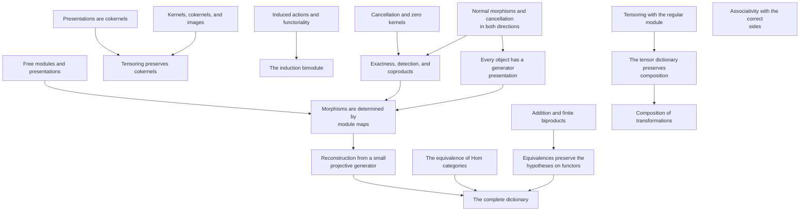

# Categorical prerequisites for bimodule string diagrams

All listed results compiled and passed the axiom audit.

[Article](https://getcurious.cc/downloads/abelian-categories-and-bimodules-lecture-notes.pdf) · [Alphabeta Math](https://getcurious.cc/downloads/abelian-categories-and-bimodules-lecture-notes.pdf)

## Dependency overview

20 landmark definitions and results. Arrows follow dependency paths, with intermediate items omitted. [Full dependency graph](DEPENDENCIES.md) · [Exact proof graph and suppliers](proof-graph.json).

[Proof dependency graph](proof-graph.json) includes exact Lean suppliers and coverage.

## External proofs

The only external library used is [mathlib](https://github.com/leanprover-community/mathlib4); see the [full list of external proofs](EXTERNAL_PROOFS.md).

## Navigation and verification

- [PROJECT.md](PROJECT.md): statements, sources, translations and dependencies.
- [EXTERNAL_PROOFS.md](EXTERNAL_PROOFS.md): external proof ledger.
- NotesProofs/: Lean declarations and proofs.
- translations/: independently reviewed types and definition values.
- evidence/: reviews, compiler diagnostics and axiom audits.

Run `lake update`, `lake exe cache get`, then `lake build`. The workflow additionally checks each declaration's axioms, permitting only propext, Classical.choice and Quot.sound.
